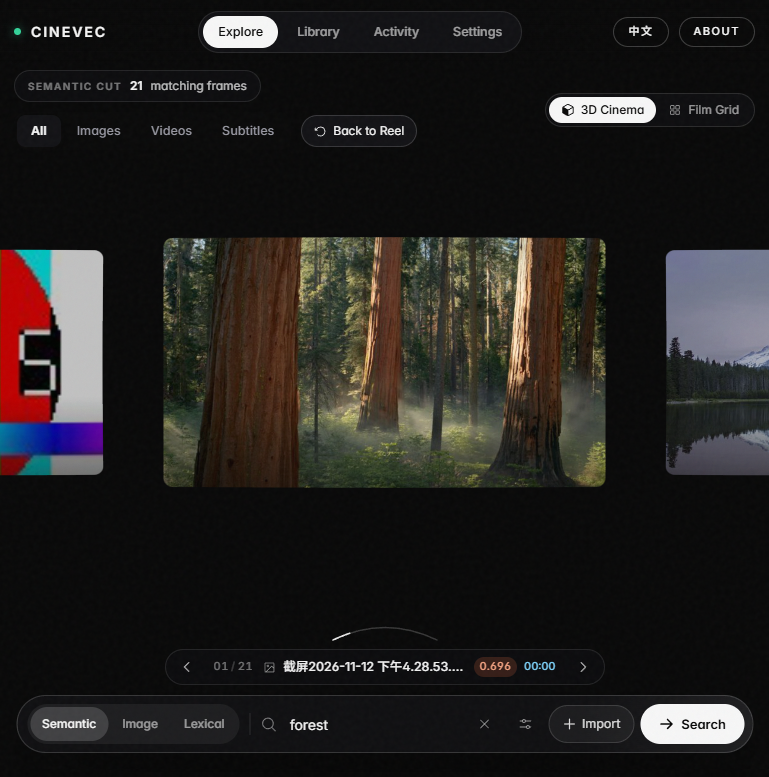
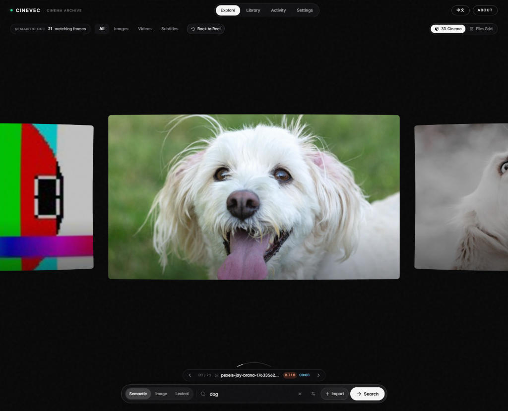
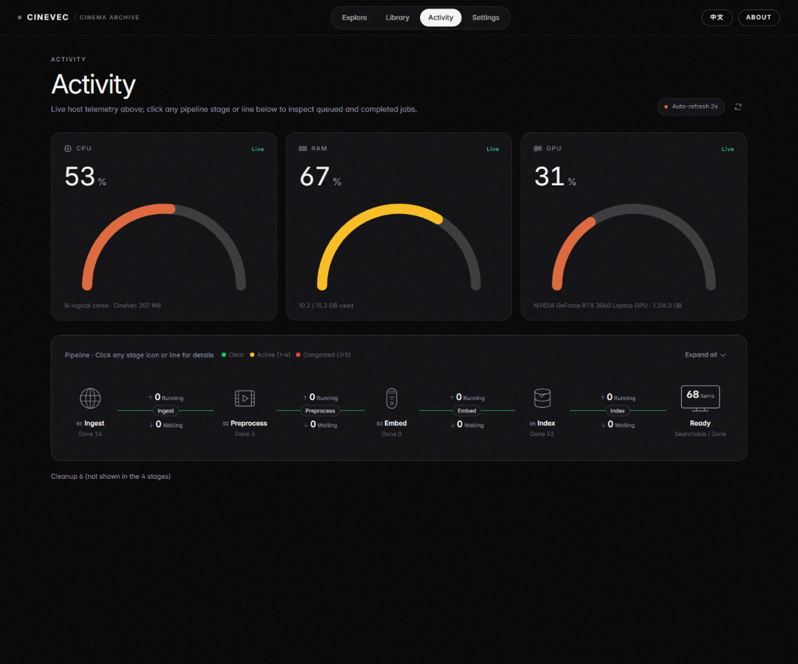
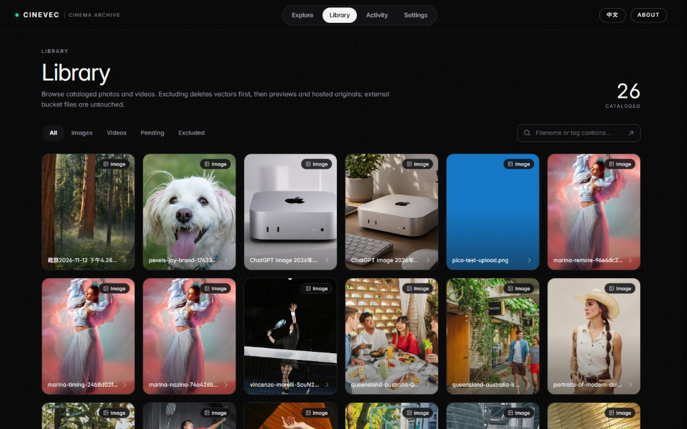

<div align="center">

# CineVec

### Buscador Multimodal Autoalojado con Sala de Proyección 3D

**Deja de jugar al detective con `VID_20240819_final_FINAL2.mp4`.**
Describe una escena, arrastra una captura o busca una frase de subtítulos — CineVec te lleva al segundo exacto del vídeo dentro de un corredor 3D WebGL.

[English](README.md) · [简体中文](README.zh-CN.md) · [日本語](README.ja.md) · [한국어](README.ko.md) · **Español**

[-4285F4?style=for-the-badge&logo=google&logoColor=white)](https://ai.google.dev/)
[](https://milvus.io/)
[](https://fastapi.tiangolo.com/)
[](https://threejs.org/)
[](https://min.io/)

[Qué hace](#qué-hace-cinevec) • [Capturas](#galería-visual) • [Ventajas](#por-qué-cinevec-destaca) • [Plugins y CineGram](#ecosistema-de-plugins--cinegram) • [Cambiar Backends](#cómo-cambiar-la-bd-vectorial-modelos-o-almacenamiento) • [Despliegue Rápido](#despliegue-rápido)

</div>

---

## Qué hace CineVec

**CineVec** es un **motor multimodal autoalojado de archivo y búsqueda semántica** para editores de vídeo, coleccionistas y entusiastas del *self-hosting* con miles de clips imposibles de ordenar a mano.

- **Tres modos en un solo dock**: búsqueda semántica en lenguaje natural, búsqueda visual arrastrando una imagen de referencia y búsqueda léxica instantánea por nombre, etiquetas y descripciones.
- **Sala de proyección con salto exacto**: los resultados de vídeo saltan directamente al segundo del fotograma coincidente, con tira de fotogramas, portadas personalizadas y línea de tiempo de subtítulos `.srt/.vtt/.ass`.
- **Guía interactiva en el primer inicio**: al abrirlo por primera vez, un modal verifica tu configuración y un tour con burbujas junto a cada botón te explica cómo usarlo.

---

## Galería visual

<table>
  <tr>
    <td width="50%" align="center">
      
      <br />
      <sub><b>Consulta: <code>"forest"</code></b> — Corredor 3D resaltando la mejor toma (cosine <code>0.696</code>)</sub>
    </td>
    <td width="50%" align="center">
      
      <br />
      <sub><b>Consulta: <code>"dog"</code></b> — Clasificación instantánea de escenas similares (cosine <code>0.718</code>)</sub>
    </td>
  </tr>
  <tr>
    <td width="50%" align="center">
      
      <br />
      <sub><b>Panel de actividad</b> — Telemetría CPU / RAM / GPU y pipeline en 4 etapas</sub>
    </td>
    <td width="50%" align="center">
      
      <br />
      <sub><b>Biblioteca</b> — Filtros, etiquetado masivo, portadas personalizadas y purga segura</sub>
    </td>
  </tr>
</table>

---

## Por qué CineVec destaca

| Característica | Galerías tradicionales | CineVec |
| :--- | :--- | :--- |
| **Espacio en disco** | Duplican terabytes de vídeo en su carpeta propietaria. | **Modo Zero-Retention**: guarda `source_url`, miniaturas ligeras y vectores; borra el archivo original temporal en cuanto extrae fotogramas. |
| **Ingesta masiva** | Una GPU lenta bloquea todo y acumula vídeos en disco. | **Worker de doble carril**: `preprocess` (FFmpeg) y `embed` corren en hilos separados; el vídeo bruto se elimina al instante. |
| **BD Vectorial** | Exigen montar un clúster Milvus/etcd completo. | **Milvus Lite integrado** (un solo archivo en Docker Compose), o cambia una variable para usar **Milvus REST v2**. |
| **Buckets externos** | Mueven o alteran tus archivos. | **Multi-Bucket S3/MinIO solo lectura**: jamás toca tus buckets externos y purga vectores antes de limpiar vistas previas. |
| **Extensibilidad** | Solo subida manual desde la web. | **API de plugins `/api/v1/*`** con tokens Bearer para crear tus propios conectores en cualquier lenguaje. |

---

## Ecosistema de Plugins & CineGram

CineVec se mantiene limpio como núcleo de búsqueda; los bots, scripts y extensiones se conectan mediante `/api/v1/*` con Bearer API Tokens (**Settings → API Tokens**).

### Plugin oficial de Telegram: **[CineGram](https://github.com/Chillwinner/CineGram)**

> **Repositorio**: [https://github.com/Chillwinner/CineGram](https://github.com/Chillwinner/CineGram)

- **Cuenta MTProto y Bot totalmente opcionales**: funciona en modo solo Web, solo Bot, solo MTProto o dual.
- **Importación selectiva**: reglas de filtrado por grupo (tipo, tamaño, duración, palabras clave, días) **más** un explorador web de miniaturas para marcar solo los mensajes que deseas importar.
- **Herencia de texto y `#etiquetas` en álbumes**: propaga automáticamente la descripción del primer archivo al resto del álbum de Telegram.
- **Monitor de disponibilidad**: detecta cambios de nombre, pasos a grupo privado o mensajes borrados y actualiza `source_url` o marca `source_invalid`.

---

## Cómo cambiar la BD vectorial, modelos o almacenamiento

CineVec usa una **arquitectura hexagonal (Ports & Adapters)**: la capa de aplicación solo depende de los `Protocol` definidos en [`backend/app/domain/ports.py`](backend/app/domain/ports.py).

### 1. Cambios sin código (solo `.env`)
- **BD Vectorial**: **Milvus Lite** (`PICA_MILVUS_BACKEND=lite`) ↔ **Milvus REST v2** (`PICA_MILVUS_URI=http://...`).
- **Modelo**: **EmbeddingGemma 2** (HTTP) ↔ **Chinese-CLIP** (HTTP o ONNX local).
- **Almacenamiento**: MinIO, AWS S3, Cloudflare R2 o cualquier endpoint S3.

### 2. ¿Quieres usar Qdrant, pgvector, Weaviate o tu propio modelo?
**Sí — solo implementa el `Protocol` correspondiente y conéctalo en la fábrica (sin tocar el pipeline ni la UI):**

| Componente | Interfaz (`backend/app/domain/ports.py`) | Referencia (`backend/app/infra/`) | Fábrica (`backend/app/main.py`) |
| :--- | :--- | :--- | :--- |
| **BD Vectorial** | `VectorIndex` | `milvus_lite.py` / `milvus_rest.py` | `build_vector_index()` |
| **Modelo Imagen/Texto** | `ImageTextEncoder` | `embeddinggemma_http.py` / `clip_http.py` | `build_encoders()` |
| **Modelo Subtítulos** | `SubtitleEncoder` | `clip_http.py` / `chinese_clip.py` | `build_encoders()` |
| **Almacenamiento** | `FileStore` | `file_store.py` | `build_file_store()` |
| **Fuente solo lectura** | `SourceReader` | `s3_reader.py` | `build_container()` |

```python
class MyCustomVectorIndex:
    def available(self) -> bool: ...
    def status_message(self) -> str: ...
    def upsert_records(self, modality: str, records: list[dict]) -> int: ...
    def search(self, modality: str, vector: list[float], *, limit: int, offset: int = 0, filter_expr: str | None = None) -> list[dict]: ...
    def delete_vectors(self, refs: list) -> VectorDeleteResult: ...
    def delete_by_asset(self, asset_id: str, collections: list[str] | None = None) -> VectorDeleteResult: ...
```

---

## Despliegue rápido

### Opción A: Docker Compose en 1 clic (Recomendado · 2 minutos)

Incluye **MinIO** (bucket creado y registrado automáticamente), **Milvus Lite** integrado, **FFmpeg** y la **Web UI 3D** lista para producción:

```bash
git clone https://github.com/Chillwinner/Cinevec.git
cd Cinevec
cp .env.docker.example .env
# Edita .env y apunta PICA_CLIP_HTTP_BASE_URL a tu servicio de embeddings
docker compose up -d
```

Abre **http://localhost:5174** — el asistente inicial comprobará tus servicios y te guiará botón por botón.

### Opción B: Desarrollo local manual

```bash
cp .env.example backend/.env

# Backend (puerto 8008)
cd backend && python -m venv .venv && source .venv/bin/activate
pip install -r requirements.txt && pip install "pymilvus[milvus_lite]>=2.4.9"
uvicorn app.main:app --host 127.0.0.1 --port 8008

# Frontend (puerto 5174) en otra terminal
cd web && npm install && npm run dev
```
