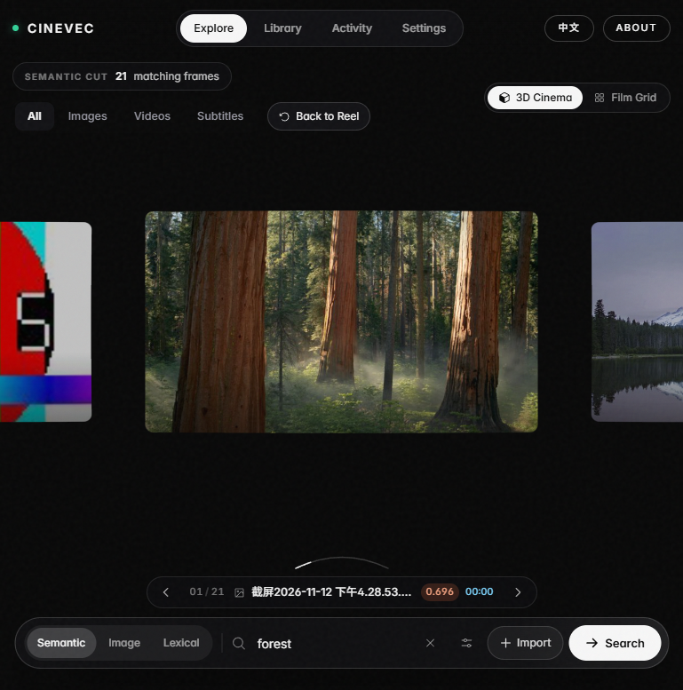
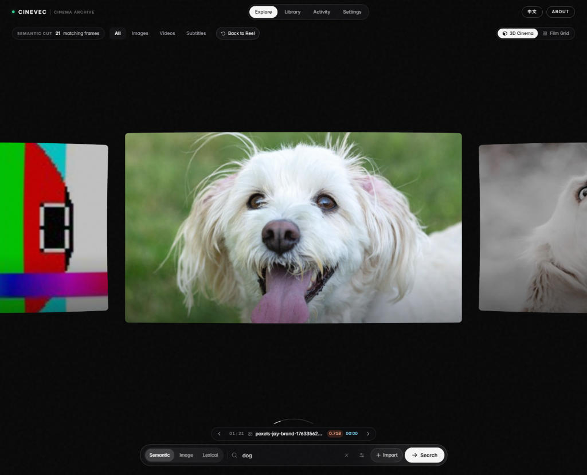
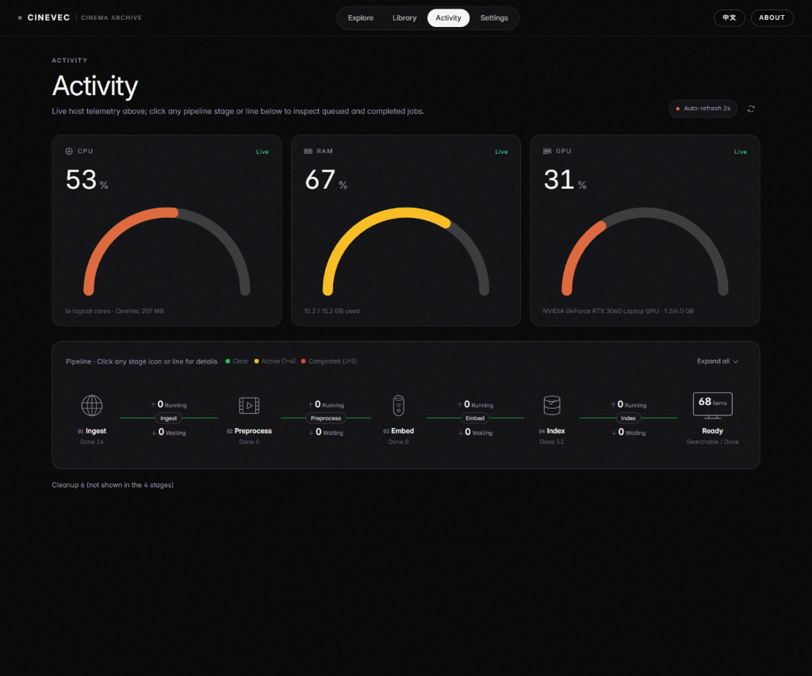
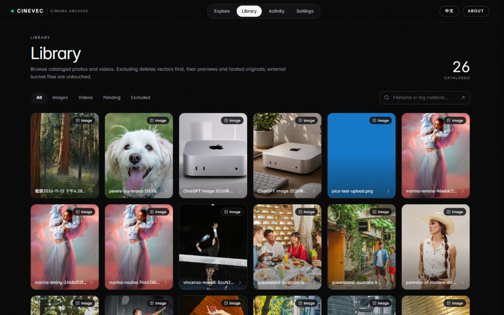

<div align="center">

# CineVec

### シネマ級 3D スクリーニング UI を備えたセルフホスト型マルチモーダルメディア検索

**`VID_20240819_final_FINAL2.mp4` を探す探偵ごっこはもう終わりにしましょう。**
シーンの文章入力・参考画像のドラッグ＆ドロップ・字幕検索だけで、3D WebGL シアターから該当タイムスタンプへ一発ジャンプできます。

[English](README.md) · [简体中文](README.zh-CN.md) · **日本語** · [한국어](README.ko.md) · [Español](README.es.md)

[-4285F4?style=for-the-badge&logo=google&logoColor=white)](https://ai.google.dev/)
[](https://milvus.io/)
[](https://fastapi.tiangolo.com/)
[](https://threejs.org/)
[](https://min.io/)

[機能](#できること) • [スクリーンショット](#ビジュアルショーケース) • [強み](#他ツールとの違い) • [推奨構成 & EmbeddingGemma 2](#推奨スペックと-embeddinggemma-2-を選ぶ理由) • [プラグイン & CineGram](#プラグインエコシステム--cinegram) • [レゴ式疎結合設計](#完全疎結合モデルベクトル-dbストレージを自由に組み合わせ) • [クイックスタート & Compose カスタマイズ](#クイックスタートと-docker-composeyml-カスタマイズ)

</div>

---

## できること

**CineVec** は、大量の動画素材やスクリーンショットを抱える映像クリエイター・コレクター向けの**セルフホスト型マルチモーダル検索ハブ**です。

- **3 つの検索モードを 1 つのドックに集約**：自然言語でのセマンティック検索、参考画像ドロップによる類似フレーム検索、ファイル名・タグ・説明文の高速レキシカル検索。
- **タイムスタンプ直行スクリーニングルーム**：ヒットした動画は該当キーフレームの秒数から即再生。キーフレームフィルムストリップ、カスタムカバー、`.srt/.vtt/.ass` 字幕タイムラインに対応。
- **5 言語 UI ＆ 初回起動インタラクティブガイド**：Web UI は `EN / 中文 / 日本語 / 한국어 / ES` に対応（既定は英語、`localStorage` で選択言語を自動記憶）。初回アクセス時は設定確認モーダル＋各ボタンのスポットライトツアーが自動起動します。

---

## ビジュアルショーケース

<table>
  <tr>
    <td width="50%" align="center">
      
      <br />
      <sub><b>クエリ: <code>"forest"</code></b> — 3D シアター廊下で最適なカットを上位表示（cosine <code>0.696</code>）</sub>
    </td>
    <td width="50%" align="center">
      
      <br />
      <sub><b>クエリ: <code>"dog"</code></b> — 類似シーンを瞬時にランキング（cosine <code>0.718</code>）</sub>
    </td>
  </tr>
  <tr>
    <td width="50%" align="center">
      
      <br />
      <sub><b>アクティビティダッシュボード</b> — CPU / RAM / GPU ゲージと 4 段階パイプライン</sub>
    </td>
    <td width="50%" align="center">
      
      <br />
      <sub><b>ライブラリカタログ</b> — 絞り込み、一括タグ付け、カバー変更、安全削除</sub>
    </td>
  </tr>
</table>

---

## 他ツールとの違い

| 機能 | 一般的なギャラリーツール | CineVec |
| :--- | :--- | :--- |
| **ストレージ容量** | 元動画を丸ごと複製してディスクを圧迫。 | **Zero-Retention モード**：`source_url` のみ紐づけ、キーフレーム抽出直後に一時元ファイルを削除。軽量プレビューとベクトルだけ保持。 |
| **大量動画の取り込み** | GPU 推論待ちで前処理が詰まり元動画が堆積。 | **デュアルレーン並列ワーカー**：前処理（FFmpeg）とベクトル化を別スレッド化し、抽出後即座に元動画を削除。 |
| **ベクトル DB 運用** | Milvus + etcd + MinIO の構築が重い。 | **Milvus Lite 標準内蔵**（Docker Compose は単一ファイル動作）。環境変数 1 つで **Milvus REST v2** クラスタへ移行可能。 |
| **モデル＆構成の自由度** | 特定モデルが本体コードにベタ書き。 | **二層レゴ式疎結合**：EmbeddingGemma 2 は独立コンテナ（`encoder/`）として分離。他モデルや別マシン GPU へ自由に差し替え可能。 |
| **外部バケット安全性** | 既存ファイルを移動・改変しがち。 | **読み取り専用マルチバケット**：外部 S3/MinIO は一切変更せず、削除時もベクトル優先パージで整合性を保証。 |
| **拡張性 & UX** | Web 画面からの手動アップロード限定。 | **プラグイン専用 `/api/v1/*` API** + **3D WebGL シアター** + **5 言語永続化 UI**。 |

---

## 推奨スペックと EmbeddingGemma 2 を選ぶ理由

### 家庭用セルフホスト推奨スペック（本体とモデルを分けて計算）

CineVec は**家庭用サーバーや NAS での軽量運用**を前提に設計されています。内蔵 **Milvus Lite**（クラスタ不要）を採用し、**本体**と**エンコーダモデル**を分離して配置できます：

| コンポーネント | CPU / メモリ目安 | ディスク | 備考 |
| :--- | :--- | :--- | :--- |
| **CineVec 本体**（Backend + Milvus Lite + Web UI） | **1–2 vCPU · 0.5 GB 未満**（MinIO 込み約 0.8 GB） | 5 GB+ | 非常に軽量で、エントリー NAS やミニ PC に 24 時間常駐可能。 |
| **エンコーダモデル**（推奨：**`EmbeddingGemma 2`**） | **2 コア+ CPU · 約 2.5 GB メモリ**（GPU / Mac MPS なら高速） | 約 2 GB 重みキャッシュ | 音声タワー無効化で約 440M パラメータ。同居でも別 PC/GPU マシンへのオフロードでも可。 |

- **1 台完結の推奨環境**：**4 コア CPU · 4–6 GB メモリ · 10 GB+ ディスク**（N100 ミニ PC や家庭用 NAS で GPU なしでも動作）。
- **メモリ節約構成**：NAS が 2 GB メモリしかない場合、NAS には **0.5 GB 未満の本体**だけを置き、**約 2.5 GB の `EmbeddingGemma 2`** は普段使いの PC や Mac で動かして `PICA_CLIP_HTTP_BASE_URL` で接続できます。

### なぜ標準モデルに `google/embeddinggemma-2` を採用したのか？

1. **モジュラー設計による省メモリ化（実効約 440M パラメータ）**：
   全体では 740M パラメータ（テキスト 270M + 画像 170M + 音声 300M）ですが、CineVec は画像・動画フレーム・字幕のみを扱うため `EMBED_DISABLE_AUDIO=true`（`audio_config=None`）で音声タワーを無効化しています。約 300M 分のメモリを削減でき、家庭用 GPU や Mac、CPU 環境でも軽快に動作します。
2. **100 以上の言語を 1 つの 768 次元空間へ統合**：
   日本語・英語・中国語・韓国語・スペイン語が混在していても、単一の 768 次元ベクトル空間でシームレスに横断検索できます。
3. **センタークロップなしの全画面入力（Full-Frame Passthrough）**：
   従来の CLIP ラッパーのように横長映像の中央だけを正方形に切り抜いて字幕や端の人物を欠落させることなく、フレーム全体をエンコードします。
4. **8K コンテキスト長 ＆ 二重プレフィックス防止**：
   長い字幕もそのまま処理し、検索クエリとドキュメントのタスク接頭辞を厳密に 1 回だけ付与します。
5. **Apache 2.0 ライセンス ＆ `float16` オーバーフロー保護**：
   `float16` で活性化が飽和する問題を避けるため、エンコーダサービスは **`bfloat16`** または **`float32`** のみを許可します。

---

## プラグインエコシステム & CineGram

CineVec 本体は「検索コア」に専念し、外部連携はすべて `/api/v1/*` + Bearer API Token（**Settings → API Tokens** で発行）で疎結合に接続します。

### 公式 Telegram プラグイン：**[CineGram](https://github.com/Chillwinner/CineGram)**

> **リポジトリ**: [https://github.com/Chillwinner/CineGram](https://github.com/Chillwinner/CineGram)

- **MTProto ＆ Bot は両方オプション**：Web のみ / Bot のみ / MTProto のみ / デュアルモードを自由に選択可能。
- **選択的インポート**：グループ別フィルタ規則に加え、**Web 画面でサムネイルを見ながらチェックしたメッセージだけ取り込み**可能。
- **アルバム本文＆`#タグ` 自動継承**：Telegram アルバムの 2 枚目以降にもキャプションと `#タグ` を自動コピー。
- **リンク生存監視**：グループ名変更・非公開化・削除を定期巡回し、`source_url` 更新や `source_invalid` 反映を自動化。

---

## 完全疎結合：モデル・ベクトル DB・ストレージを自由に組み合わせ

CineVec は **コンテナ層** と **コード層** の二段階で疎結合化されています。

### 1. サービス（コンテナ）層のレゴブロック構成

`web`、`backend`（+ Milvus Lite）、`encoder`、`minio` はすべて HTTP / REST / S3 経由で独立して動作します。`backend` は意図的に `depends_on: encoder` を設定していないため、`encoder` コンテナを外して別マシンのモデルを繋いでも問題なく起動します。

### 2. コード層のヘキサゴナル設計（Ports & Adapters）

ビジネスロジックは [`backend/app/domain/ports.py`](backend/app/domain/ports.py) の `Protocol` のみに依存しています：
- **コード変更なしで切り替え（`.env` のみ）**：Milvus Lite ↔ Milvus REST v2、EmbeddingGemma 2 ↔ Chinese-CLIP、MinIO ↔ AWS S3 / Cloudflare R2 / OSS。
- **Qdrant・pgvector・独自モデルを繋ぎたい場合**：対応する `Protocol` を実装して [`backend/app/main.py`](backend/app/main.py) のファクトリ関数に登録するだけです（パイプラインや 3D UI の改修不要）。

| 差し替え対象 | インターフェース (`backend/app/domain/ports.py`) | 参考実装 (`backend/app/infra/`) | 登録先 (`backend/app/main.py`) |
| :--- | :--- | :--- | :--- |
| **ベクトル DB** | `VectorIndex` | `milvus_lite.py` / `milvus_rest.py` | `build_vector_index()` |
| **画像・テキストモデル** | `ImageTextEncoder` | `embeddinggemma_http.py` / `clip_http.py` / `chinese_clip.py` | `build_encoders()` |
| **字幕モデル** | `SubtitleEncoder` | `embeddinggemma_http.py` / `clip_http.py` / `chinese_clip.py` | `build_encoders()` |
| **ファイル保存** | `FileStore` | `file_store.py` | `build_file_store()` |
| **読み取り専用ソース** | `SourceReader` | `s3_reader.py` | `build_container()` |

---

## クイックスタートと `docker-compose.yml` カスタマイズ

### オールインワン起動（EmbeddingGemma 2 内蔵）

**MinIO**、内蔵 **Milvus Lite**、**EmbeddingGemma 2** コンテナ、**FFmpeg**、本番 **3D Web UI** をまとめて起動します：

```bash
git clone https://github.com/Chillwinner/Cinevec.git
cd Cinevec
cp .env.docker.example .env
# 必要なら .env に HF_TOKEN（または HF_ENDPOINT）を設定

# CPU / デフォルト起動:
docker compose up -d

# NVIDIA GPU を使う場合 (bfloat16):
docker compose -f docker-compose.yml -f docker-compose.gpu.yml up -d
```

ブラウザで **http://localhost:5174** を開くと、初回ガイドが状態チェックと操作手順を案内します。

---

### 独自コンポーネントを組み込む場合の `docker-compose.yml` 編集方法

#### ケース 1：外部モデル / Mac (Apple Silicon MPS) / 別マシンの GPU を使う
macOS の Docker は Metal GPU を使えないため、Mac ではエンコーダだけホスト側で動かすのが高速です：
1. [`docker-compose.yml`](docker-compose.yml) から `encoder:` ブロックをコメントアウト（または `docker compose up -d minio minio-init backend web` を実行）。
2. ホスト側でエンコーダを起動：
   ```bash
   python3 -m venv .venv-encoder && source .venv-encoder/bin/activate
   pip install "torch>=2.4.0" -r encoder/requirements.txt
   EMBED_DEVICE=mps HF_TOKEN=your_token uvicorn server:app --app-dir encoder --host 0.0.0.0 --port 8001
   ```
3. `.env` を編集：`PICA_CLIP_HTTP_BASE_URL=http://host.docker.internal:8001`（別サーバーならその IP）。Chinese-CLIP 512d を使う場合は `PICA_MODEL_FAMILY=chinese_clip` と `PICA_MODEL_DIM=512` に変更します。

#### ケース 2：独立した Milvus REST v2 クラスタへ切り替え
`docker-compose.yml` の変更は不要です。`.env` に以下を設定します：
```env
PICA_MILVUS_BACKEND=rest
PICA_MILVUS_URI=http://your-milvus:19530
```

#### ケース 3：既存の S3 / Cloudflare R2 / Aliyun OSS / 既存 MinIO を使う
[`docker-compose.yml`](docker-compose.yml) の `minio:`・`minio-init:` と `backend.depends_on` をコメントアウトし、`.env` の `PICA_S3_*` に接続先を設定してください。
