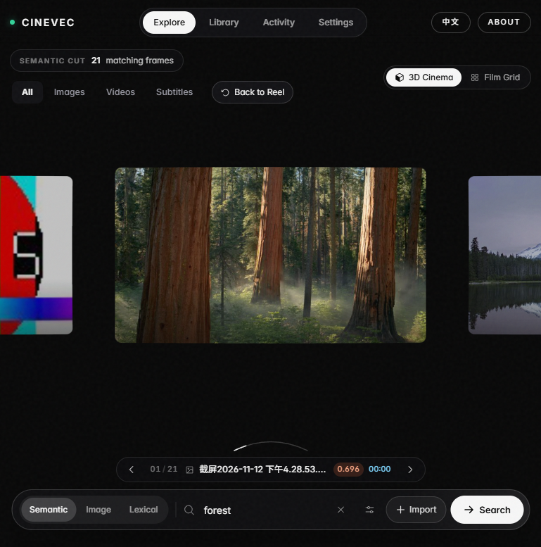
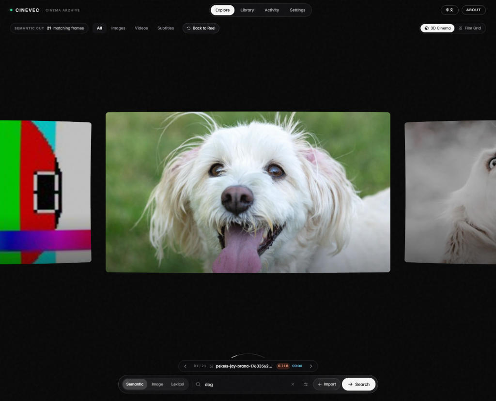
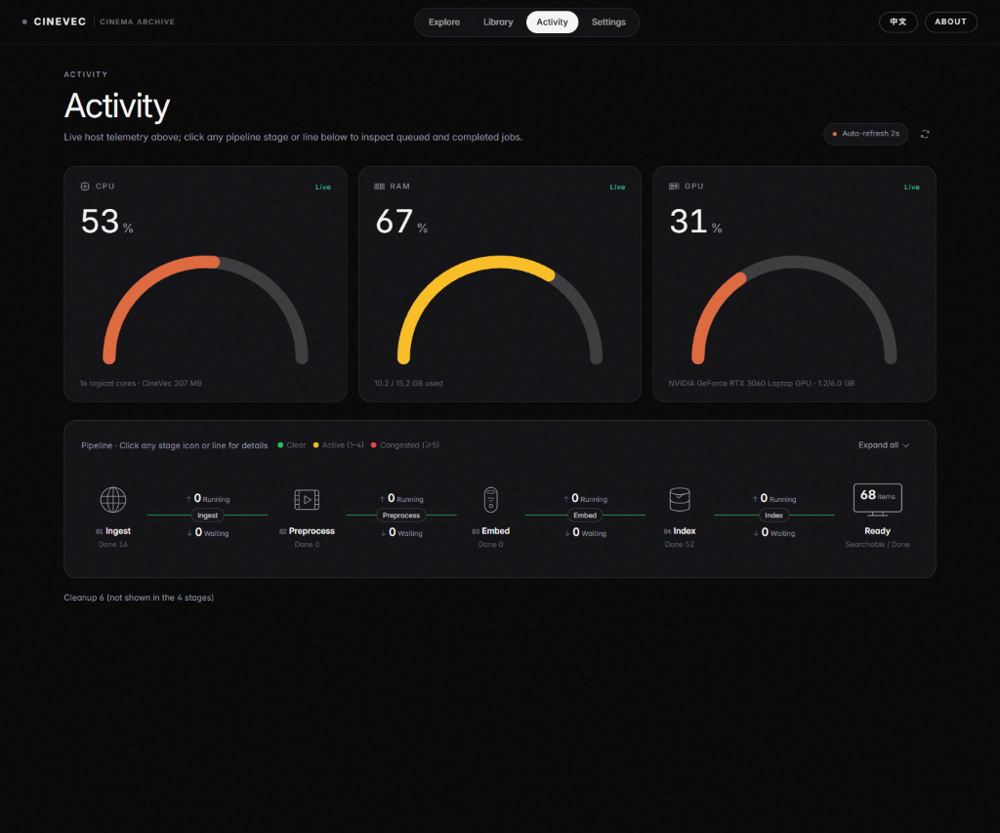
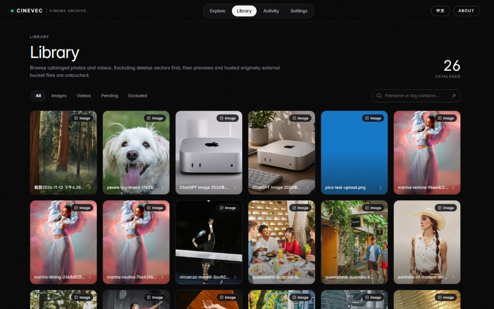

<div align="center">

# CineVec

### 시네마급 3D 스크리닝 UI를 갖춘 셀프호스팅 멀티모달 미디어 검색 엔진

**`VID_20240819_final_FINAL2.mp4` 파일명을 기억하느라 고생하지 마세요.**
장면을 말로 설명하거나, 스크린샷을 드롭하거나, 대사를 검색하면 3D WebGL 상영관에서 정확한 타임스탬프로 바로 이동합니다.

[English](README.md) · [简体中文](README.zh-CN.md) · [日本語](README.ja.md) · **한국어** · [Español](README.es.md)

[-4285F4?style=for-the-badge&logo=google&logoColor=white)](https://ai.google.dev/)
[](https://milvus.io/)
[](https://fastapi.tiangolo.com/)
[](https://threejs.org/)
[](https://min.io/)

[주요 기능](#주요-기능) • [화면 미리보기](#화면-미리보기) • [차별점](#다른-도구와-비교한-장점) • [권장 사양 & EmbeddingGemma 2](#권장-사양-및-embeddinggemma-2-채택-이유) • [플러그인 & CineGram](#플러그인-생태계--cinegram) • [레고식 분리 아키텍처](#진정한-레고식-모듈-분리--원하는-구성요소로-자유-교체) • [빠른 배포 & Compose 커스텀](#빠른-배포-및-docker-composeyml-커스터마이징)

</div>

---

## 주요 기능

**CineVec**은 수만 개의 영상 클립과 이미지를 관리하는 편집자·수집가·셀프호스팅 사용자를 위한 **멀티모달 시맨틱 미디어 아카이브**입니다.

- **하나의 도크에서 3가지 검색**: 자연어 장면 검색, 참조 이미지 드래그 앤 드롭 유사 샷 검색, 파일명·태그·설명 기반 초고속 어휘 검색.
- **타임스탬프 즉시 이동 상영관**: 검색된 영상은 매칭된 키프레임 초로 바로 점프하며, 키프레임 필름스트립·커스텀 커버·`.srt/.vtt/.ass` 자막 타임라인을 지원합니다.
- **5개 언어 UI & 첫 실행 온보딩 투어**: `EN / 中文 / 日本語 / 한국어 / ES` 5개 언어(기본 영어, `localStorage` 자동 기억)와 최초 접속 시 설정 점검 모달·스포트라이트 가이드를 제공합니다.

---

## 화면 미리보기

<table>
  <tr>
    <td width="50%" align="center">
      
      <br />
      <sub><b>검색어: <code>"forest"</code></b> — 3D 시네마 복도에서 가장 유사한 장면을 최상단 배치 (cosine <code>0.696</code>)</sub>
    </td>
    <td width="50%" align="center">
      
      <br />
      <sub><b>검색어: <code>"dog"</code></b> — 관련 장면을 실시간 랭킹 (cosine <code>0.718</code>)</sub>
    </td>
  </tr>
  <tr>
    <td width="50%" align="center">
      
      <br />
      <sub><b>활동 대시보드</b> — 실시간 CPU / RAM / GPU 게이지 및 4단계 파이프라인</sub>
    </td>
    <td width="50%" align="center">
      
      <br />
      <sub><b>라이브러리</b> — 필터링, 일괄 태깅, 커스텀 커버, 설명 편집 및 안전한 삭제</sub>
    </td>
  </tr>
</table>

---

## 다른 도구와 비교한 장점

| 항목 | 일반 미디어 갤러리 | CineVec |
| :--- | :--- | :--- |
| **디스크 용량** | 원본 영상을 통째로 복사해 저장 공간 낭비. | **Zero-Retention 모드**: `source_url`만 기록하고 키프레임 추출 직후 임시 원본 삭제. 가벼운 미리보기와 벡터만 유지. |
| **대량 영상 처리** | GPU 임베딩 대기 중 원본 영상이 로컬에 쌓임. | **듀얼 레인 비동기 워커**: 전처리(FFmpeg)와 임베딩 스레드를 분리해 추출 즉시 원본 삭제. |
| **벡터 DB 운영** | Milvus + etcd 클러스터 구축 부담. | **Milvus Lite 기본 내장**(Docker Compose 단일 파일 동작), 환경변수 하나로 **Milvus REST v2** 클러스터 전환 가능. |
| **모델 및 스택 자유도** | 단일 CLIP 모델이 백엔드 코드에 강하게 결합. | **2계층 레고 아키텍처**: EmbeddingGemma 2가 독립 컨테이너(`encoder/`)로 동작하며 언제든 모델·벡터 DB·스토리지 교체 가능. |
| **외부 버킷 보호** | 원본 파일 이동 또는 변경 위험. | **읽기 전용 멀티 버킷**: 외부 S3/MinIO 원본은 절대 수정하지 않으며, 삭제 시 벡터 우선 정리. |
| **플러그인 확장성** | 웹 UI 수동 업로드만 지원. | **플러그인 전용 `/api/v1/*` API** + **Three.js 3D 갤러리** + **5개 언어 자동 저장 UI**. |

---

## 권장 사양 및 `EmbeddingGemma 2` 채택 이유

### 가정용 홈서버 권장 사양 (본체와 모델 분리 계산)

CineVec은 **가정용 NAS 및 미니 PC 배포**에 최적화되어 있습니다. 내장 **Milvus Lite**(클러스터 불필요)를 사용하며 **본체**와 **임베딩 모델**을 분리해 계산·배치할 수 있습니다:

| 구성 요소 | CPU / 메모리 점유율 | 디스크 | 설명 |
| :--- | :--- | :--- | :--- |
| **CineVec 본체** (Backend + Milvus Lite + Web UI) | **1–2코어 · 0.5 GB 미만** (MinIO 포함 약 0.8 GB) | 5 GB+ | 매우 가벼워 보급형 NAS나 미니 PC에 상시 구동 가능. |
| **임베딩 모델** (권장: **`EmbeddingGemma 2`**) | **2코어+ CPU · 약 2.5 GB 메모리** (GPU / Mac MPS 지원) | 약 2 GB 가중치 캐시 | 오디오 타워 제외 시 약 440M 파라미터. 같은 기기 또는 별도 PC/GPU 서버에 분리 실행 가능. |

- **올인원 가정용 권장 사양**: **4코어 CPU · 4–6 GB RAM · 10 GB+ 디스크** (N100 미니 PC, 구형 노트북, 가정용 NAS에서 외장 GPU 없이 실행 가능).
- **분리 절약 구성**: NAS 메모리가 2 GB뿐이라면 NAS에는 **0.5 GB 미만의 본체**만 두고, **~2.5 GB의 `EmbeddingGemma 2`**는 평소 쓰는 PC나 Mac에서 실행해 `PICA_CLIP_HTTP_BASE_URL`로 연결하면 됩니다.

### 왜 기본 모델로 `google/embeddinggemma-2`를 쓰나요?

1. **모듈형 경량화 (활성 파라미터 ~440M)**:
   전체 740M 모델(텍스트 270M + 비전 170M + 오디오 300M) 중 CineVec은 이미지·영상 프레임·자막만 색인하므로 `EMBED_DISABLE_AUDIO=true`(`audio_config=None`)로 300M 오디오 타워를 끕니다. 소비자용 GPU, Mac, CPU 환경에서도 가볍게 돌아갑니다.
2. **100개 이상 언어를 하나의 768차원 공간에 통합**:
   한국어·영어·중국어·일본어·스페인어를 섞어 검색해도 별도 모델 없이 동일한 768차원 공간에서 화면과 자막을 함께 찾습니다.
3. **잘림 없는 전체 프레임 입력(Full-Frame Passthrough)**:
   화면 중앙만 정사각형으로 잘라내 자막이나 가장자리 피사체를 잃는 기존 CLIP의 한계 없이 전체 프레임을 그대로 임베딩합니다.
4. **8K 컨텍스트 창 & 중복 없는 비대칭 태스크 프롬프트**:
   긴 자막 문맥을 넉넉히 수용하며, 검색 쿼리와 문서 접두사를 서버/클라이언트 단에서 정확히 한 번만 적용합니다.
5. **Apache 2.0 라이선스 & 정밀도 안전 가드**:
   `float16`에서 활성화 값이 오버플로우되는 문제를 막기 위해 **`bfloat16`** 또는 **`float32`** 만 허용합니다.

---

## 플러그인 생태계 & CineGram

CineVec 코어는 검색 엔진 역할에 집중하며, 모든 외부 수집기·봇·자동화 도구는 `/api/v1/*`와 Bearer API Token(**Settings → API Tokens**)으로 완전히 분리 연동됩니다.

### 공식 Telegram 플러그인: **[CineGram](https://github.com/Chillwinner/CineGram)**

> **저장소**: [https://github.com/Chillwinner/CineGram](https://github.com/Chillwinner/CineGram)

- **MTProto 계정과 Bot 모두 선택 사항**: Web 전용 / Bot 전용 / MTProto 전용 / 듀얼 모드 지원.
- **선택적 가져오기**: 그룹별 필터 규칙과 **웹에서 썸네일을 보고 체크한 항목만 가져오는 UI** 제공.
- **앨범 캡션 및 `#태그` 자동 상속**: 여러 파일을 한 번에 올릴 때 첫 메시지에만 붙는 캡션을 그룹 내 모든 파일에 자동 적용.
- **링크 생존 점검**: 채널 이름 변경, 비공개 전환, 메시지 삭제를 주기적으로 점검해 `source_url` 갱신 또는 `source_invalid` 표시.

---

## 진정한 레고식 모듈 분리 — 원하는 구성요소로 자유 교체

CineVec은 **컨테이너 서비스 계층**과 **백엔드 코드 계층** 두 단계에서 완전히 분리되어 있습니다.

### 1. 컨테이너 서비스 계층 (독립 블록 조립)

`web`, `backend`(+ Milvus Lite), `encoder`, `minio`는 HTTP / REST / S3 인터페이스로만 연결됩니다. `backend`는 의도적으로 `depends_on: encoder`를 두지 않아 외부 GPU 서버로 인코더를 옮기거나 컨테이너를 제거해도 문제없이 부팅됩니다.

### 2. 코드 계층 헥사고날 아키텍처 (Ports & Adapters)

비즈니스 로직은 [`backend/app/domain/ports.py`](backend/app/domain/ports.py)의 `Protocol` 인터페이스만 의존합니다:
- **`.env`만으로 즉시 전환**: Milvus Lite ↔ Milvus REST v2, EmbeddingGemma 2 ↔ Chinese-CLIP, MinIO ↔ AWS S3 / Cloudflare R2 / OSS.
- **Qdrant·pgvector·커스텀 모델 연결**: 해당 `Protocol`을 구현해 [`backend/app/main.py`](backend/app/main.py)의 팩토리 함수에 등록하면 파이프라인과 3D UI 수정 없이 동작합니다.

| 교체 대상 | 인터페이스 (`backend/app/domain/ports.py`) | 참고 어댑터 (`backend/app/infra/`) | 연결 위치 (`backend/app/main.py`) |
| :--- | :--- | :--- | :--- |
| **벡터 DB** | `VectorIndex` | `milvus_lite.py` / `milvus_rest.py` | `build_vector_index()` |
| **이미지/텍스트 모델** | `ImageTextEncoder` | `embeddinggemma_http.py` / `clip_http.py` / `chinese_clip.py` | `build_encoders()` |
| **자막 모델** | `SubtitleEncoder` | `embeddinggemma_http.py` / `clip_http.py` / `chinese_clip.py` | `build_encoders()` |
| **파일 스토리지** | `FileStore` | `file_store.py` | `build_file_store()` |
| **읽기 전용 소스** | `SourceReader` | `s3_reader.py` | `build_container()` |

---

## 빠른 배포 및 `docker-compose.yml` 커스터마이징

### 올인원 원클릭 배포 (EmbeddingGemma 2 포함)

```bash
git clone https://github.com/Chillwinner/Cinevec.git
cd Cinevec
cp .env.docker.example .env
# 필요 시 .env에 HF_TOKEN (또는 HF_ENDPOINT) 입력

# CPU / 기본 실행:
docker compose up -d

# NVIDIA GPU 가속 실행 (bfloat16):
docker compose -f docker-compose.yml -f docker-compose.gpu.yml up -d
```

브라우저에서 **http://localhost:5174**를 열면 최초 실행 가이드가 설정 상태를 확인해 줍니다.

---

### 직접 설치하거나 교체할 때 `docker-compose.yml` 수정 가이드

#### 방법 1: 외부 모델 서버 / Mac Apple Silicon MPS 네이티브 실행
macOS용 Docker는 Metal GPU를 쓸 수 없으므로 Mac에서는 인코더만 호스트에서 직접 실행하는 것이 훨씬 빠릅니다:
1. [`docker-compose.yml`](docker-compose.yml)에서 `encoder:` 블록을 주석 처리(또는 `docker compose up -d minio minio-init backend web` 실행).
2. 호스트에서 인코더 실행:
   ```bash
   python3 -m venv .venv-encoder && source .venv-encoder/bin/activate
   pip install "torch>=2.4.0" -r encoder/requirements.txt
   EMBED_DEVICE=mps HF_TOKEN=your_token uvicorn server:app --app-dir encoder --host 0.0.0.0 --port 8001
   ```
3. `.env` 수정: `PICA_CLIP_HTTP_BASE_URL=http://host.docker.internal:8001` (원격 서버는 해당 IP 입력; Chinese-CLIP 512d 사용 시 `PICA_MODEL_FAMILY=chinese_clip`, `PICA_MODEL_DIM=512`로 변경).

#### 방법 2: 내장 Milvus Lite 대신 독립 Milvus REST v2 클러스터 연결
`docker-compose.yml` 수정 없이 `.env`에 두 줄만 바꾸면 됩니다:
```env
PICA_MILVUS_BACKEND=rest
PICA_MILVUS_URI=http://your-milvus:19530
```

#### 방법 3: 기존 S3 / Cloudflare R2 / Aliyun OSS / 외부 MinIO 사용
[`docker-compose.yml`](docker-compose.yml)에서 `minio:`, `minio-init:` 서비스와 `backend.depends_on`을 제거한 뒤 `.env`에 `PICA_S3_*` 값을 입력하세요.
