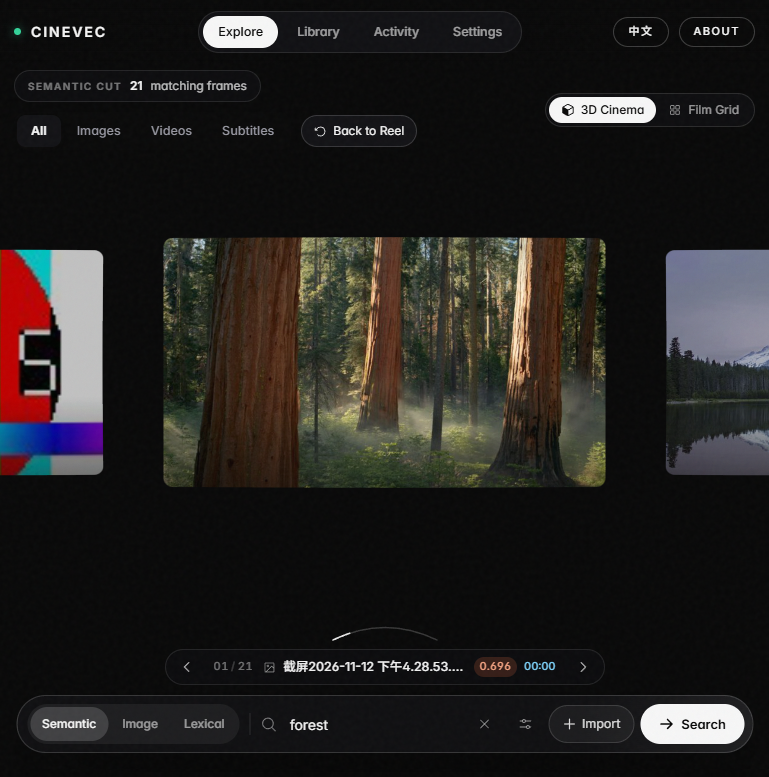
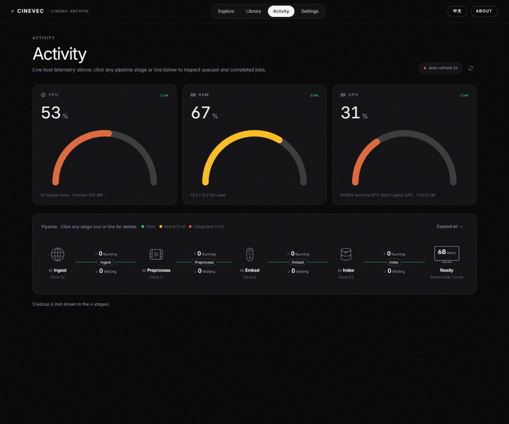
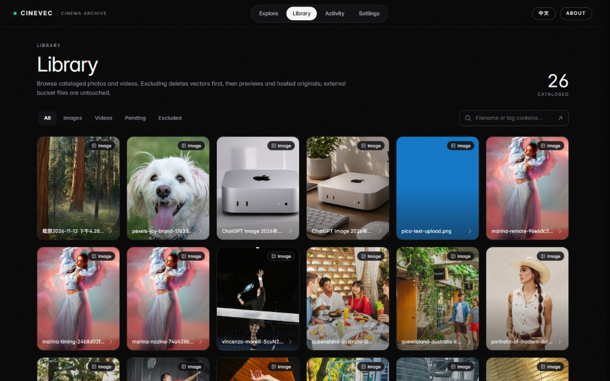

<div align="center">

# CineVec

### Self-Hosted Multimodal Media Search with a Cinema-Grade 3D Screening UI

**Stop playing detective with `VID_20240819_final_FINAL2.mp4`.**
Type a scene, drop a screenshot, or search a subtitle line — CineVec flies you straight to the exact video timestamp in a 3D WebGL screening room.

**English** · [简体中文](README.zh-CN.md) · [日本語](README.ja.md) · [한국어](README.ko.md) · [Español](README.es.md)

[-4285F4?style=for-the-badge&logo=google&logoColor=white)](https://ai.google.dev/)
[](https://milvus.io/)
[](https://fastapi.tiangolo.com/)
[](https://threejs.org/)
[](https://min.io/)

[What It Does](#what-cinevec-does) • [Showcase](#visual-showcase) • [Why CineVec](#why-cinevec-beats-the-usual-suspects) • [Plugins & CineGram](#plugin-ecosystem--cinegram) • [Swap Backends](#swapping-vector-dbs-models--storage) • [Quickstart](#quickstart-deployment)

</div>

---

## What CineVec Does

CineVec is a **self-hosted multimodal media archive & semantic search engine** built for video editors, collectors, and AI tinkerers who own way too many clips and screenshots to ever organize by hand.

- **Three Search Modalities in One Dock**: Natural-language visual search (*"redwood forest sunlight"*), image-to-frame drag-and-drop search, and instant lexical search across filenames, tags, and descriptions.
- **Timestamp-Accurate Screening Room**: Video hits open directly at the matched keyframe second, complete with a keyframe filmstrip, custom covers, and inline `.srt/.vtt/.ass` subtitle cues.
- **First-Run Guided Walkthrough**: Fresh installs launch an interactive setup checklist + spotlight button tour so nobody has to guess what to configure or click first.

---

## Visual Showcase

### Multimodal Semantic Search — 3D Cinema Mode

<table>
  <tr>
    <td width="50%" align="center">
      
      <br />
      <sub><b>Query: <code>"forest"</code></b> — 3D Cinema corridor highlighting top redwood frame (cosine <code>0.696</code>)</sub>
    </td>
    <td width="50%" align="center">
      
      <br />
      <sub><b>Query: <code>"dog"</code></b> — 3D Cinema corridor ranking dog portraits at the top (cosine <code>0.718</code>)</sub>
    </td>
  </tr>
</table>

### Hardware Telemetry, 4-Stage Pipeline & Library Catalog

<table>
  <tr>
    <td width="50%" align="center">
      
      <br />
      <sub><b>Activity Dashboard</b> — Live CPU / RAM / GPU gauges &amp; 4-stage traffic-light pipeline</sub>
    </td>
    <td width="50%" align="center">
      
      <br />
      <sub><b>Library Catalog</b> — Filtering, batch tagging, custom covers, descriptions &amp; safe purge</sub>
    </td>
  </tr>
</table>

---

## Why CineVec Beats the Usual Suspects

Most self-hosted galleries either force you to duplicate terabytes of video into their proprietary folder, choke your disk while waiting on GPU inference, or trap you inside a monolithic codebase. CineVec takes a different route:

| Capability | Typical Media Galleries | CineVec |
| :--- | :--- | :--- |
| **Storage Footprint** | Copies every original file into its own vault. | **Zero-Retention Mode**: attach a `source_url`, keep only lightweight previews + vectors, and delete the raw original right after keyframe sampling. |
| **Batch Video Ingestion** | One slow GPU call stalls everything; raw videos pile up on disk. | **Dual-Lane Worker**: `preprocess` (FFmpeg) and `embed` (GPU/HTTP) run on separate threads. Raw videos are deleted the instant frames are extracted. |
| **Vector DB Ops** | Requires a 3-container Milvus/etcd/MinIO cluster just to test. | **Milvus Lite out of the box** (`data/milvus_lite.db` in Docker Compose), or flip one env var to connect a full **Milvus REST v2** cluster. |
| **External Buckets** | Moves or mutates your files. | **Read-Only Multi-Bucket S3/MinIO**: external buckets are never modified; safe purge deletes vectors first, then previews. |
| **Extensibility** | Hardcoded UI-only uploads. | **First-Class Plugin API (`/api/v1/*`)** with scoped Bearer tokens, batch progress, `ref_id` dedup, and external `lifecycle` sync. |
| **UX Polish** | Static thumbnail grid. | **Three.js 3D Cinema Corridor**, bilingual (`EN / 中文`) HUD, live CPU/RAM/GPU telemetry, and first-run interactive onboarding. |

---

## Plugin Ecosystem & CineGram

CineVec is designed as a **clean retrieval core** — ingest bots, browser clippers, and automation scripts talk strictly over `/api/v1/*` with a scoped Bearer API token (generated in **Settings → Plugin API Tokens**), zero database coupling required.

### Official Telegram Plugin: **[CineGram](https://github.com/Chillwinner/CineGram)**

Want to turn Telegram channels & groups into a searchable 3D archive without duplicating gigabytes of videos? Check out our companion plugin:

> **Repository**: [https://github.com/Chillwinner/CineGram](https://github.com/Chillwinner/CineGram)

- **MTProto User Account + Optional Bot** (both completely optional — run Web-only, Bot-only, MTProto-only, or Dual mode).
- **Selective Ingestion**: per-group filter rules (media type, file size, duration, keywords, lookback days) **plus** a lightweight Web UI to browse channel thumbnails and cherry-pick which messages to import.
- **Media Group Caption & `#tag` Inheritance**: multi-file Telegram albums automatically propagate captions and `#hashtags` to every sibling file so nothing gets missed in lexical or tag search.
- **Availability Watcher**: periodically checks if a group renamed, turned private, or deleted messages, automatically updating `source_url` or flagging `lifecycle="source_invalid"`.

Want to write your own plugin (Discord, Obsidian, Chrome extension, NAS watcher)? Just call `POST /api/v1/imports`, `GET /api/v1/batches/{id}`, `PATCH /api/v1/assets/{id}`, and `POST /api/v1/search/text|image|metadata` — no need to touch CineVec's backend code.

---

## Swapping Vector DBs, Models & Storage

CineVec follows a strict **Hexagonal (Ports & Adapters)** architecture. Business logic in `backend/app/application/` never imports Milvus, MinIO, or any specific model directly — it only talks to `Protocol` interfaces in [`backend/app/domain/ports.py`](backend/app/domain/ports.py).

### 1. Already Built-In (Zero Code — Just `.env`)
- **Vector DB**: Switch between embedded **Milvus Lite** (`PICA_MILVUS_BACKEND=lite`) and remote **Milvus REST v2** (`PICA_MILVUS_URI=http://...`).
- **Multimodal Encoder**: Switch between **EmbeddingGemma 2** (`remote_http`) and **Chinese-CLIP** (`remote_http` or `local_onnx`).
- **Object Storage**: Any S3-compatible store (MinIO, AWS S3, Cloudflare R2, Aliyun OSS).

### 2. Want to Plug In Qdrant, pgvector, Weaviate, or a Custom Model?
**Yes — you implement the corresponding `Protocol` interface (just 2 touchpoints, zero changes to pipeline/search/UI):**

| Component | Port Interface (`backend/app/domain/ports.py`) | Reference Adapter (`backend/app/infra/`) | Wiring Factory (`backend/app/main.py`) |
| :--- | :--- | :--- | :--- |
| **Vector DB** | `VectorIndex` | `milvus_lite.py` / `milvus_rest.py` | `build_vector_index()` |
| **Image/Text Encoder** | `ImageTextEncoder` | `embeddinggemma_http.py` / `clip_http.py` / `chinese_clip.py` | `build_encoders()` |
| **Subtitle Encoder** | `SubtitleEncoder` | `clip_http.py` / `chinese_clip.py` | `build_encoders()` |
| **Platform Storage** | `FileStore` | `file_store.py` | `build_file_store()` |
| **Read-Only Source** | `SourceReader` | `s3_reader.py` | `build_container()` |

For example, swapping in **Qdrant** or **pgvector** only requires implementing these 5 core methods of `VectorIndex`:

```python
class MyCustomVectorIndex:
    def available(self) -> bool: ...
    def status_message(self) -> str: ...
    def upsert_records(self, modality: str, records: list[dict]) -> int: ...
    def search(self, modality: str, vector: list[float], *, limit: int, offset: int = 0, filter_expr: str | None = None) -> list[dict]: ...
    def delete_vectors(self, refs: list) -> VectorDeleteResult: ...
    def delete_by_asset(self, asset_id: str, collections: list[str] | None = None) -> VectorDeleteResult: ...
```

Then return your adapter inside `build_vector_index()` in [`backend/app/main.py`](backend/app/main.py) — search aggregation, safe vector-first purge, model-space rebuilds, and the 3D Cinema UI all work automatically.

---

## Quickstart Deployment

### Option A: One-Click Docker Compose (Recommended — 2 Minutes)

Includes **MinIO** (bucket auto-created & auto-registered), embedded **Milvus Lite** (no Milvus cluster needed), **FFmpeg**, and the production **Nginx + 3D Web UI**:

```bash
git clone https://github.com/Chillwinner/Cinevec.git
cd Cinevec
cp .env.docker.example .env
# Edit .env and set PICA_CLIP_HTTP_BASE_URL to your embedding model HTTP endpoint
docker compose up -d
```

Open **http://localhost:5174** — the built-in first-run onboarding wizard will check your services and walk you through every button.

### Option B: Manual Local Development

**Prerequisites**: Python 3.11+, Node.js 20+, FFmpeg, MinIO/S3, and an embedding service (or local Chinese-CLIP ONNX).

```bash
# 1. Configure backend environment (NEVER commit backend/.env or backend/data/*.db)
cp .env.example backend/.env

# 2. Start Backend (port 8008) — SQLite & Milvus Lite auto-initialize on first run
cd backend
python -m venv .venv
source .venv/bin/activate        # Windows PowerShell: .\.venv\Scripts\Activate.ps1
pip install -r requirements.txt
pip install "pymilvus[milvus_lite]>=2.4.9"   # optional: only needed if using Milvus Lite locally
uvicorn app.main:app --host 127.0.0.1 --port 8008

# 3. Start Frontend (port 5174) in a second terminal
cd web
npm install
npm run dev
```

Open **http://127.0.0.1:5174** in your browser.

### Verification & Tests

```bash
cd backend && pytest -q
cd web && npm run build && npm test
```
