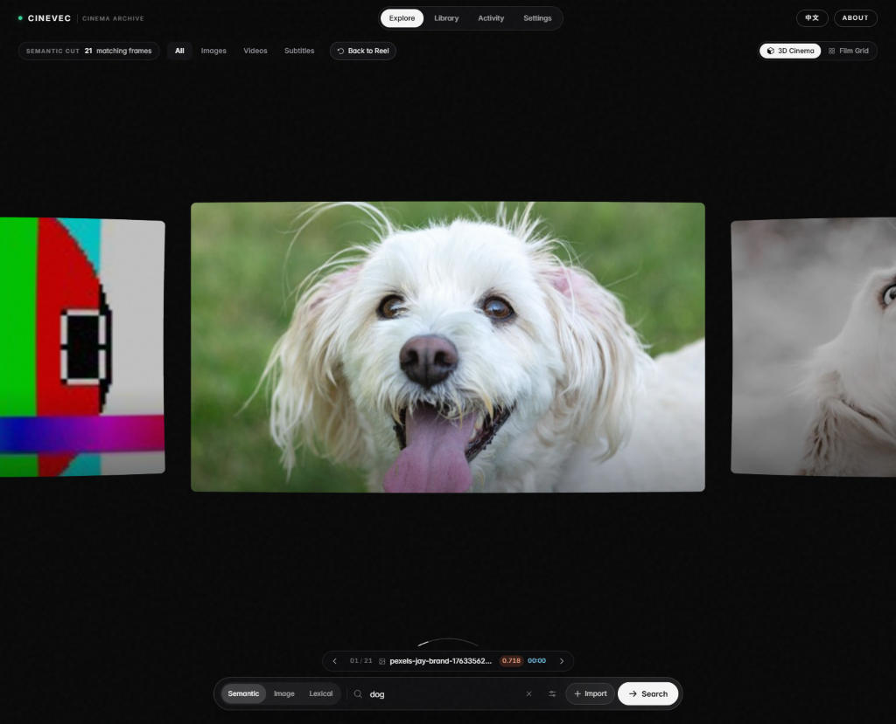

<div align="center">

# CineVec

### Self-Hosted Multimodal Media Search with a Cinema-Grade 3D Screening UI

**Stop playing detective with `VID_20240819_final_FINAL2.mp4`.**
Type a scene, drop a screenshot, or search a subtitle line — CineVec flies you straight to the exact video timestamp in a 3D WebGL screening room.

**English** · [简体中文](README.zh-CN.md) · [日本語](README.ja.md) · [한국어](README.ko.md) · [Español](README.es.md)

[-4285F4?style=for-the-badge&logo=google&logoColor=white)](https://ai.google.dev/)
[](https://milvus.io/)
[](https://fastapi.tiangolo.com/)
[](https://threejs.org/)
[](https://min.io/)

[What It Does](#what-cinevec-does) • [Showcase](#visual-showcase) • [Why CineVec](#why-cinevec-beats-the-usual-suspects) • [Specs & EmbeddingGemma 2](#recommended-specs--why-embeddinggemma-2) • [Plugins & CineGram](#plugin-ecosystem--cinegram) • [Lego Architecture](#true-lego-block-decoupling--swap-anything) • [Quickstart & Compose Recipes](#quickstart--customizing-docker-composeyml)

</div>

---

## What CineVec Does

CineVec is a **self-hosted multimodal media archive & semantic search engine** built for video editors, collectors, and AI tinkerers who own way too many clips and screenshots to ever organize by hand.

- **Three Search Modalities in One Dock**: Natural-language visual search (*"redwood forest sunlight"*), image-to-frame drag-and-drop search, and instant lexical search across filenames, tags, and descriptions.
- **Timestamp-Accurate Screening Room**: Video hits open directly at the matched keyframe second, complete with a keyframe filmstrip, custom covers, and inline `.srt/.vtt/.ass` subtitle cues.
- **5-Language HUD & Interactive Walkthrough**: Web UI supports `EN / 中文 / 日本語 / 한국어 / ES` (defaults to English, remembers your choice in `localStorage`), plus a first-run configuration modal and spotlight button tour so newcomers know what every knob does on day one.

---

## Visual Showcase

### Multimodal Semantic Search — 3D Cinema Mode

<table>
  <tr>
    <td width="50%" align="center">
      
      <br />
      <sub><b>Query: <code>"forest"</code></b> — 3D Cinema corridor highlighting top redwood frame (cosine <code>0.696</code>)</sub>
    </td>
    <td width="50%" align="center">
      
      <br />
      <sub><b>Query: <code>"dog"</code></b> — 3D Cinema corridor ranking dog portraits at the top (cosine <code>0.718</code>)</sub>
    </td>
  </tr>
</table>

### Hardware Telemetry, 4-Stage Pipeline & Library Catalog

<table>
  <tr>
    <td width="50%" align="center">
      
      <br />
      <sub><b>Activity Dashboard</b> — Live CPU / RAM / GPU gauges &amp; 4-stage traffic-light pipeline</sub>
    </td>
    <td width="50%" align="center">
      
      <br />
      <sub><b>Library Catalog</b> — Filtering, batch tagging, custom covers, descriptions &amp; safe purge</sub>
    </td>
  </tr>
</table>

---

## Why CineVec Beats the Usual Suspects

Most self-hosted galleries either force you to duplicate terabytes of video into their proprietary folder, choke your disk while waiting on GPU inference, or weld one AI model to one database forever. CineVec takes a cleaner route:

| Capability | Typical Media Galleries | CineVec |
| :--- | :--- | :--- |
| **Storage Footprint** | Copies every original file into its own vault. | **Zero-Retention Mode**: attach a `source_url`, keep only lightweight previews + vectors, and delete the raw temp original right after keyframe sampling. |
| **Batch Video Ingestion** | One slow GPU call stalls everything; raw videos pile up on disk. | **Dual-Lane Worker**: `preprocess` (FFmpeg) and `embed` run on separate concurrent lanes. Raw videos are deleted the instant frames are extracted. |
| **Vector DB Ops** | Requires a 3-container Milvus/etcd/MinIO cluster just to test. | **Milvus Lite out of the box** (`data/milvus_lite.db` in Docker Compose), or flip one env var to connect a full **Milvus REST v2** cluster. |
| **Model & Stack Freedom** | Hardcoded to one baked-in CLIP weight inside a giant monolith. | **Two-Layer Lego Architecture**: the EmbeddingGemma 2 encoder runs in its own container (`encoder/`) over HTTP — swap, scale, or move it to another GPU box anytime. |
| **External Buckets** | Moves or mutates your files. | **Read-Only Multi-Bucket S3/MinIO**: external buckets are never modified; safe purge deletes vectors first, then previews. |
| **Extensibility & UX** | Static grid; UI-only manual upload. | **First-Class Plugin API (`/api/v1/*`)** with Bearer tokens + **Three.js 3D Cinema Corridor**, **5-language UI**, live telemetry, and first-run guided tour. |

---

## Recommended Specs & Why EmbeddingGemma 2

### Recommended Hardware & Configuration

| Tier | CPU / GPU / RAM | Disk | Typical Use Case | Suggested Encoder Config |
| :--- | :--- | :--- | :--- | :--- |
| **Starter (CPU-Only)** | 4 vCPU · 8 GB RAM | 20 GB SSD | Small archives (<10k frames), testing, zero GPU servers | Default `docker compose up -d` (`EMBED_DEVICE=cpu`, `TORCH_INDEX_URL=https://download.pytorch.org/whl/cpu`) |
| **Recommended Daily Driver** | 6+ cores · **NVIDIA GPU (6–8 GB VRAM)** or **Apple Silicon (16 GB+ Unified RAM)** · 16 GB RAM | 50 GB+ NVMe | Fast video keyframe ingestion, smooth interactive semantic search | Linux/Windows GPU: `docker compose -f docker-compose.yml -f docker-compose.gpu.yml up -d` (`bfloat16`) · Mac: run `encoder/server.py` natively on **MPS** |
| **Team / Heavy Scale** | 8+ cores · RTX 3080/4080+ (10–24 GB VRAM) · 32 GB+ RAM | 200 GB+ NVMe | 100k+ frames, multi-plugin ingestion, team library | Run `encoder` on dedicated GPU host + switch `PICA_MILVUS_BACKEND=rest` to standalone Milvus v2 |

### Why CineVec Defaults to `google/embeddinggemma-2`

We tried classic CLIP variants before landing on **EmbeddingGemma 2** (`google/embeddinggemma-2`) as our flagship default stack:

1. **Modular Diet (~440M Active Parameters, Not a VRAM Hog)**:
   The full model has 740M parameters (270M text/code backbone + 170M vision + 300M audio). Since CineVec indexes images, video keyframes, and `.srt/.vtt/.ass` subtitles rather than raw audio waveforms, `encoder/server.py` sets `config_kwargs={"audio_config": None}` (`EMBED_DISABLE_AUDIO=true`), trimming the active footprint by ~300M parameters so consumer GPUs, Macs, and even CPU nodes stay snappy.
2. **100+ Languages in One Shared 768-d Space**:
   Search in English, Simplified Chinese, Japanese, Korean, Spanish — or mix languages mid-sentence — and hit the exact same visual frames and subtitle cues without maintaining separate monolingual indexes.
3. **Full-Frame Vision (No Accidental Edge Cropping)**:
   Many legacy CLIP wrappers silently center-crop widescreen video to a square, chopping off people or subtitles near frame edges. CineVec passes **full uncropped frames** (`full_frame_passthrough_v1`) directly to EmbeddingGemma 2.
4. **8K Context Window + Asymmetric Task Prompts**:
   Subtitles and long captions fit comfortably inside 8K tokens, and CineVec strictly separates query prefixes (`task: search result | query: `) from document prefixes (`title: ... | text: `) with zero double-prefixing.
5. **Apache 2.0 License & Precision Guard**:
   Openly licensed for self-hosting. Because EmbeddingGemma 2 activations overflow in standard `float16`, CineVec's encoder explicitly enforces **`bfloat16`** (on supported CUDA GPUs) or **`float32`**, refusing unsafe fp16 fallback.

---

## Plugin Ecosystem & CineGram

CineVec stays razor-focused as a **clean retrieval core** — bots, scrapers, and clippers talk strictly over `/api/v1/*` with a scoped Bearer API token (generated in **Settings → Plugin API Tokens**), zero database coupling required.

### Official Telegram Plugin: **[CineGram](https://github.com/Chillwinner/CineGram)**

Turn Telegram channels & groups into a searchable 3D archive without duplicating gigabytes of videos on your NAS:

> **Repository**: [https://github.com/Chillwinner/CineGram](https://github.com/Chillwinner/CineGram)

- **Bot & MTProto Both Optional**: run Web-only, Bot-only, MTProto-only, or Dual mode.
- **Selective Ingestion**: per-group filter rules (media kind, size, duration, keywords, lookback days) **plus** a Web thumbnail picker to cherry-pick exact messages.
- **Album Caption & `#tag` Inheritance**: multi-file Telegram albums propagate captions and `#hashtags` to every sibling file so nothing hides from lexical search.
- **Availability Watcher**: detects renamed/private/kicked chats or deleted messages, refreshing `source_url` or flagging `lifecycle="source_invalid"`.

Building your own connector (Discord, Obsidian, Chrome clipper, NAS watcher)? Call `POST /api/v1/imports`, `GET /api/v1/batches/{id}`, `PATCH /api/v1/assets/{id}`, and `POST /api/v1/search/text|image|metadata`.

---

## True "Lego-Block" Decoupling — Swap Anything

CineVec is decoupled at **two independent levels** so you are never trapped in someone else's stack:

### Level 1: Service-Level Decoupling (Docker Compose Blocks)

The Compose stack consists of four loosely coupled blocks speaking standard protocols (`HTTP`, `REST v2`, `S3`):

```text
  [ web (Nginx + 3D UI :5174) ]
                │  /api proxy
                ▼
  [ backend (FastAPI :8008) + embedded Milvus Lite ]
        ├──► HTTP /api/v1/embed/* ──► [ encoder (EmbeddingGemma 2 :8001) ]  <-- swap or move to any GPU host
        └──► S3 API               ──► [ minio (:9000) ]                     <-- swap for AWS S3 / R2 / OSS
```

Notice that `backend` intentionally does **not** force `depends_on: encoder` — you can delete, replace, or host the `encoder` block on a different machine without breaking startup.

### Level 2: Code-Level Hexagonal Architecture (Ports & Adapters)

Business workflows in `backend/app/application/` never import Milvus, MinIO, Torch, or any specific model — they talk exclusively to `Protocol` interfaces in [`backend/app/domain/ports.py`](backend/app/domain/ports.py):

- **Zero-code swaps via `.env`**:
  - **Vector DB**: embedded **Milvus Lite** (`PICA_MILVUS_BACKEND=lite`) ↔ remote **Milvus REST v2** (`PICA_MILVUS_URI=http://...`)
  - **Encoder Model**: **EmbeddingGemma 2** (`remote_http`, 768d) ↔ **Chinese-CLIP** (`remote_http` or `local_onnx`, 512d)
  - **Object Storage**: MinIO, AWS S3, Cloudflare R2, Aliyun OSS, or any S3-compatible bucket
- **Swap in Qdrant, pgvector, Weaviate, or a brand-new model** by implementing just one Port interface + registering it in [`backend/app/main.py`](backend/app/main.py):

| Component | Port Interface (`backend/app/domain/ports.py`) | Reference Adapter (`backend/app/infra/`) | Wiring Factory (`backend/app/main.py`) |
| :--- | :--- | :--- | :--- |
| **Vector DB** | `VectorIndex` | `milvus_lite.py` / `milvus_rest.py` | `build_vector_index()` |
| **Image/Text Encoder** | `ImageTextEncoder` | `embeddinggemma_http.py` / `clip_http.py` / `chinese_clip.py` | `build_encoders()` |
| **Subtitle Encoder** | `SubtitleEncoder` | `embeddinggemma_http.py` / `clip_http.py` / `chinese_clip.py` | `build_encoders()` |
| **Platform Storage** | `FileStore` | `file_store.py` | `build_file_store()` |
| **Read-Only Source** | `SourceReader` | `s3_reader.py` | `build_container()` |

```python
class MyCustomVectorIndex:
    def available(self) -> bool: ...
    def status_message(self) -> str: ...
    def upsert_records(self, modality: str, records: list[dict]) -> int: ...
    def search(self, modality: str, vector: list[float], *, limit: int, offset: int = 0, filter_expr: str | None = None) -> list[dict]: ...
    def delete_vectors(self, refs: list) -> VectorDeleteResult: ...
    def delete_by_asset(self, asset_id: str, collections: list[str] | None = None) -> VectorDeleteResult: ...
```

Model spaces (`(profile, model_id, model_version, dim, preprocess_version)`) isolate collections automatically, so testing a new model never corrupts your existing index.

---

## Quickstart & Customizing `docker-compose.yml`

### All-in-One Docker Compose (Includes Built-in EmbeddingGemma 2)

Starts **MinIO** (auto-bucket + auto-registered), embedded **Milvus Lite**, the **EmbeddingGemma 2** encoder service, **FFmpeg**, and the production **3D Web UI**:

```bash
git clone https://github.com/Chillwinner/Cinevec.git
cd Cinevec
cp .env.docker.example .env

# Optional: if Hugging Face gated terms require auth for google/embeddinggemma-2, set HF_TOKEN in .env
# Optional: set HF_ENDPOINT=https://hf-mirror.com if using a Hugging Face mirror

# CPU / default start:
docker compose up -d

# Or with NVIDIA GPU acceleration (bfloat16):
docker compose -f docker-compose.yml -f docker-compose.gpu.yml up -d
```

Open **http://localhost:5174** (the built-in onboarding modal checks every block and walks you through the UI; the `encoder` downloads weights to `hf_cache` once on first boot).

> Tip: For a smaller CPU-only `encoder` image, set `TORCH_INDEX_URL=https://download.pytorch.org/whl/cpu` in `.env` before building.

---

### Customizing `docker-compose.yml` (Bring Your Own Components)

#### Recipe 1: Use Your Own Model, Apple Silicon Mac (MPS), or Remote GPU Server

Want to run `encoder/server.py` natively on your Mac for **Apple Silicon MPS** acceleration (Docker on macOS cannot access Metal GPU), point to a beefier GPU workstation, or use Chinese-CLIP instead?

1. **Skip or remove the `encoder:` block** in [`docker-compose.yml`](docker-compose.yml) (or simply start the stack without it):
   ```bash
   docker compose up -d minio minio-init backend web
   ```
2. **Run the encoder natively on your Mac / GPU box** (or start your own compatible HTTP encoder):
   ```bash
   python3 -m venv .venv-encoder && source .venv-encoder/bin/activate
   pip install "torch>=2.4.0" -r encoder/requirements.txt
   EMBED_DEVICE=mps HF_TOKEN=your_hf_token uvicorn server:app --app-dir encoder --host 0.0.0.0 --port 8001
   ```
3. **Point `backend` to it in `.env`**:
   ```env
   # Host machine on Docker Desktop:
   PICA_CLIP_HTTP_BASE_URL=http://host.docker.internal:8001
   # Or a remote GPU box on your LAN:
   # PICA_CLIP_HTTP_BASE_URL=http://192.168.1.50:8001
   ```
   *(Switching to **Chinese-CLIP**? Simply also update `PICA_MODEL_FAMILY=chinese_clip`, `PICA_MODEL_ARCHITECTURE=ViT-B-16`, `PICA_MODEL_ID=chinese-clip-vit-b-16`, `PICA_MODEL_DIM=512`, `PICA_PREPROCESS_VERSION=chinese_clip_official_square_v1` in `.env`.)*

#### Recipe 2: Swap Milvus Lite for an External Milvus REST v2 Cluster

Outgrew single-file Milvus Lite? Keep `docker-compose.yml` untouched and switch two lines in `.env`:

```env
PICA_MILVUS_BACKEND=rest
PICA_MILVUS_URI=http://your-milvus-host:19530
```

Or add your own `milvus:` service block to `docker-compose.yml` and set `PICA_MILVUS_URI=http://milvus:19530`.

#### Recipe 3: Bring Your Own Object Storage (Existing MinIO / AWS S3 / Cloudflare R2 / OSS)

1. Comment out or remove the `minio:` and `minio-init:` services in [`docker-compose.yml`](docker-compose.yml), and remove the `depends_on: minio-init` block under `backend:`.
2. Fill your external S3 credentials in `.env`:
   ```env
   PICA_AUTO_INIT_PLATFORM_STORAGE=true
   PICA_S3_ENDPOINT=https://your-s3-or-r2-endpoint
   PICA_S3_REGION=auto
   PICA_S3_BUCKET=cinevec-media
   PICA_S3_ACCESS_KEY=your-access-key
   PICA_S3_SECRET_KEY=your-secret-key
   ```

---

### Local Manual Development & Tests

```bash
cp .env.example backend/.env
cd backend && python -m venv .venv && source .venv/bin/activate
pip install -r requirements.txt && pip install "pymilvus[milvus_lite]>=2.4.9"
uvicorn app.main:app --host 127.0.0.1 --port 8008

# In a second terminal (Frontend :5174)
cd web && npm install && npm run dev

# Verification tests
cd backend && pytest -q
PYTHONPATH=backend:encoder backend/.venv/bin/pytest -q encoder/test_server.py
cd web && npm run build && npm test
```
