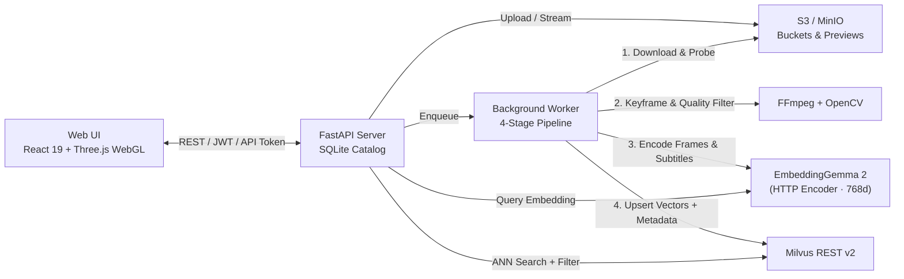

<div align="center">

# CineVec

### Self-Hosted Multimodal Media Search with a Cinema-Grade 3D Screening UI

Powered by **Google EmbeddingGemma 2**, **Milvus REST v2**, **FFmpeg**, and **S3 / MinIO** — with **Zero-Retention Indexing** and **Bilingual (`EN / 中文`) UI**.

[English](README.md) · [简体中文](README.zh-CN.md)

[-4285F4?style=for-the-badge&logo=google&logoColor=white)](https://ai.google.dev/)
[](https://milvus.io/)
[](https://fastapi.tiangolo.com/)
[](https://threejs.org/)
[](https://min.io/)

[Features](#key-features) • [Showcase](#visual-showcase) • [Architecture](#architecture) • [Quickstart](#quickstart) • [Configuration](#configuration) • [API](#plugin--rest-api)

</div>

---

## Why CineVec?

Most self-hosted media galleries stop at filename or EXIF search. **CineVec** brings high-dimensional multimodal retrieval and a cinema-grade screening experience to your own infrastructure — without locking your files into a proprietary format or forcing you to duplicate terabytes of video.

| Capability | How CineVec Handles It |
| :--- | :--- |
| **Multimodal Retrieval** | Powered by **`google/embeddinggemma-2`** (768-dim `float32` vectors, `full_frame_passthrough_v1`), with pluggable support for **Chinese-CLIP** (HTTP or local ONNX). |
| **3D WebGL Cinema** | Browse search hits in a curved **Three.js 3D cylindrical corridor** or switch to **Film Grid**. Open any hit in the **Screening Room** for instant timestamp seeking. |
| **Zero-Retention Mode** | Uncheck *"Store original file in S3"* and attach a `source_url` — CineVec keeps only lightweight previews, covers, and vectors, deleting the temporary original after ingestion. |
| **Vector-First Safe Purge** | Excluding an asset deletes its Milvus vectors **first**, and only cleans previews/hosted originals once vector removal is confirmed. External S3 buckets are never modified. |
| **Live Pipeline Telemetry** | Real-time **CPU, RAM, and NVIDIA GPU** gauges (Windows / Linux / macOS) paired with a traffic-light 4-stage pipeline (`Ingest` → `Preprocess` → `Embed` → `Index`). |
| **Bilingual UI (`EN / 中文`)** | Defaults to English with instant `EN / 中文` switching in the top HUD bar. |

---

## Visual Showcase

### Multimodal Semantic Search — 3D Cinema Mode

<table>
  <tr>
    <td width="50%" align="center">
      
      <br />
      <sub><b>Query: <code>"forest"</code></b> — 3D Cinema corridor highlighting top redwood frame (cosine <code>0.696</code>)</sub>
    </td>
    <td width="50%" align="center">
      
      <br />
      <sub><b>Query: <code>"dog"</code></b> — 3D Cinema corridor ranking dog portraits at the top (cosine <code>0.718</code>)</sub>
    </td>
  </tr>
</table>

### Hardware Telemetry, 4-Stage Pipeline & Library Catalog

<table>
  <tr>
    <td width="50%" align="center">
      
      <br />
      <sub><b>Activity Dashboard</b> — Live CPU / RAM / GPU gauges & expandable 4-stage traffic-light pipeline</sub>
    </td>
    <td width="50%" align="center">
      
      <br />
      <sub><b>Library Catalog</b> — Asset filtering, batch tagging, custom covers, descriptions & safe purge</sub>
    </td>
  </tr>
</table>

---

## Key Features

### 1. Three Search Modalities in One Director Dock
- **Semantic Text**: Search visual scenes, objects, mood, and subtitle dialogue in natural language.
- **Image-to-Frame**: Drag & drop any reference image onto the stage to find visually similar shots.
- **Lexical Metadata**: Fast substring matching across filenames, tags, and editable asset descriptions.

### 2. Interactive Screening Room
- **Instant Timestamp Jump**: Video hits seek directly to the matched keyframe timestamp.
- **Keyframe Filmstrip & Custom Covers**: Scrub through extracted keyframes or upload a custom poster cover.
- **Subtitle Timeline**: Explicitly bind `.srt`, `.vtt`, or `.ass` subtitles and inspect matched cues inline.

### 3. Non-Destructive Multi-Bucket Storage
- Connect multiple S3 / MinIO buckets as read-only input sources (`role: input`) without moving originals.
- Designate one bucket as platform storage (`is_platform_storage: true`) for previews, covers, and optional hosted uploads.

---

## Architecture



### 4-Stage Background Pipeline

| Stage | Name | Responsibility |
| :---: | :--- | :--- |
| `01` | **Ingest** | Registers assets from local upload or external S3/MinIO keys and tracks `asset_id` + version provenance. |
| `02` | **Preprocess** | Samples video keyframes via FFmpeg (`interval_seconds`, `uniform_total`, or `frames_per_minute`), filters black/white/blurry/duplicate frames, and generates WebP/JPEG previews. |
| `03` | **Embed** | Sends frames, descriptions, and subtitle cues to **EmbeddingGemma 2** (768-dim) or Chinese-CLIP. |
| `04` | **Index** | Upserts vectors and unified `asset_id` / `version` metadata into **Milvus REST v2** and activates searchable state. |

---

## Quickstart

### Prerequisites

- **Python 3.11+** & **Node.js 20+**
- **FFmpeg** (in `PATH` or configured via `PICA_FFMPEG_PATH`)
- **Milvus v2.4+** (with REST API v2 enabled)
- **MinIO** or any S3-compatible object storage
- **Embedding Service**: Remote HTTP encoder serving **EmbeddingGemma 2** (`google/embeddinggemma-2`, 768d) — or local Chinese-CLIP ONNX models

### 1. Configure Environment

Copy the showcase template and fill in your local service endpoints and credentials:

```bash
cp .env.example backend/.env
```

> [!IMPORTANT]
> Never commit `backend/.env`, `backend/data/*.db`, or real S3/JWT secrets. All environment variables retain the `PICA_*` prefix for full backward compatibility.

### 2. Start the Backend

```bash
cd backend
python -m venv .venv

# Windows (PowerShell)
.\.venv\Scripts\Activate.ps1
# Linux / macOS
# source .venv/bin/activate

pip install -r requirements.txt
uvicorn app.main:app --host 127.0.0.1 --port 8008
```

### 3. Start the Frontend

```bash
cd web
npm install
npm run dev -- --host 127.0.0.1 --port 5174
```

Open **http://127.0.0.1:5174** in your browser.

---

## Configuration

Key settings in `backend/.env` (see [`.env.example`](.env.example) for the complete annotated template):

| Group | Key Variables | Description |
| :--- | :--- | :--- |
| **Encoder (EmbeddingGemma 2)** | `PICA_ENCODER_BACKEND=remote_http`<br/>`PICA_MODEL_FAMILY=embeddinggemma2`<br/>`PICA_MODEL_ARCHITECTURE=google/embeddinggemma-2`<br/>`PICA_MODEL_DIM=768`<br/>`PICA_PREPROCESS_VERSION=full_frame_passthrough_v1` | Primary multimodal embedding profile via HTTP encoder (`PICA_CLIP_HTTP_BASE_URL`). |
| **Milvus Vector DB** | `PICA_MILVUS_URI`, `PICA_MILVUS_DB`, `PICA_MILVUS_USER`, `PICA_MILVUS_PASSWORD` / `PICA_MILVUS_TOKEN` | Milvus REST v2 endpoint & credentials for vector upsert, search, and `asset_id`-scoped deletion. |
| **S3 / MinIO** | `PICA_S3_ENDPOINT`, `PICA_S3_BUCKET`, `PICA_S3_ACCESS_KEY`, `PICA_S3_SECRET_KEY` | Platform storage for previews, covers, and optional hosted originals. |
| **Sampling & Limits** | `PICA_SAMPLE_INTERVAL_SECONDS=5.0`<br/>`PICA_MAX_UPLOAD_FILES=20` | Default frame sampling interval and per-request upload guardrail (adjustable `1–500` in Settings). |

---

## Plugin & REST API

Create scoped Bearer API tokens in **Settings → Plugin API Tokens** to integrate bots, browser extensions, or external pipelines via `/api/v1/*`:

```bash
# Semantic search via Bearer token
curl -X POST http://127.0.0.1:8008/api/v1/search \
  -H "Authorization: Bearer <YOUR_API_TOKEN>" \
  -H "Content-Type: application/json" \
  -d '{"query": "redwood forest sunlight", "top_n": 10}'
```

---

## Testing & Verification

```bash
# Backend unit & integration tests
cd backend
pytest -q

# Frontend TypeScript check, Vite production bundle & auth tests
cd web
npm run build
npm test
```

---

## Project Structure

```text
Cinevec/
├── backend/
│   ├── app/
│   │   ├── main.py                        # FastAPI entrypoint, API routes & static serving
│   │   ├── application/
│   │   │   ├── lifecycle_service.py       # Exclude, restore & vector-first safe purge
│   │   │   ├── pipeline_service.py        # 4-stage worker orchestration & checkpointing
│   │   │   └── search_service.py          # Multimodal & subtitle fusion retrieval
│   │   ├── milvus.py                      # Milvus REST v2 client & collection schema
│   │   ├── embeddings.py                  # EmbeddingGemma 2 HTTP & Chinese-CLIP encoders
│   │   ├── video.py                       # FFmpeg keyframe sampling & quality filters
│   │   └── storage.py                     # S3 / MinIO adapter
│   └── tests/                             # Pytest suite
├── web/
│   ├── src/
│   │   ├── cinema/                        # Three.js 3D Carousel, ArcIndicator, ScreeningRoom
│   │   ├── pages/                         # Explore, Library, Activity, Settings, Login
│   │   ├── components/                    # Layout HUD, AddFlow, ConnectDrive, Lightbox
│   │   └── i18n.tsx                       # Bilingual EN / 中文 provider
│   └── package.json
├── docs/images/                           # Verified README screenshots
└── .env.example                           # Annotated environment template
```
