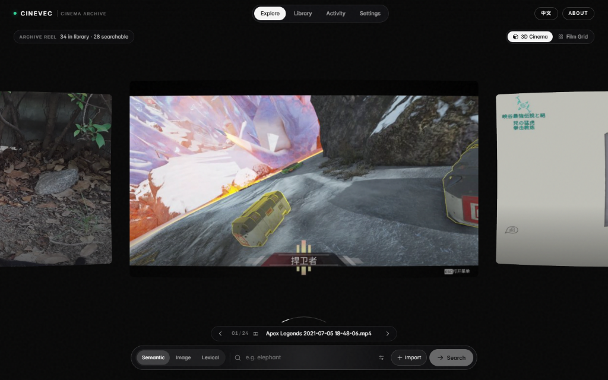
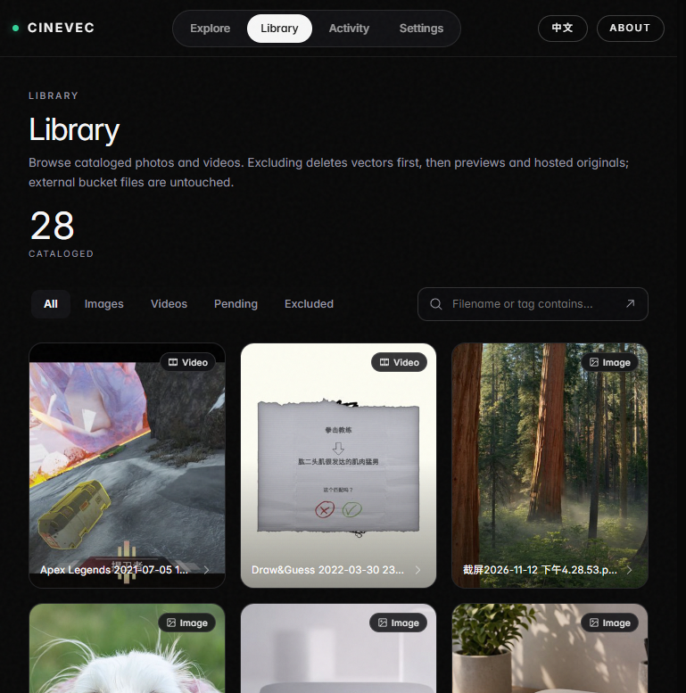
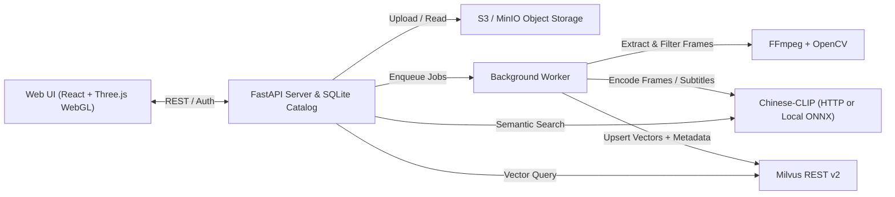

<div align="center">

# CineVec

**Self-hosted multimodal media search with a cinema-grade screening UI and zero-retention indexing.**

English | [简体中文](README.zh-CN.md)

[](https://www.python.org/)
[](https://fastapi.tiangolo.com/)
[](https://react.dev/)
[](https://threejs.org/)
[](https://milvus.io/)
[](https://min.io/)

</div>

---

## Overview

**CineVec** turns your private photo and video archives into an interactive, searchable screening room. Built around **Chinese-CLIP** (via remote HTTP or local ONNX), **Milvus REST v2**, **FFmpeg**, and **S3 / MinIO**, it lets you search across millions of frames by natural-language scene descriptions, reference images, subtitle dialogue, or metadata — without ever giving up ownership of your media.

---

## Key Features

- **3D Cinema & Screening Room UI** — Browse results in a WebGL cylindrical film corridor (`3D Cinema`) or `Film Grid`. Click any hit to open the **Screening Room** with instant timestamp seeking, keyframe filmstrip, custom cover replacement, editable descriptions, tags, and synchronized subtitle cues.
- **Multimodal + Lexical Search**
  - **Semantic Text**: Search visual scenes and dialogue (`"sunset by the sea"`, `"lit street in the rain"`).
  - **Image-to-Frame**: Drag and drop any reference image to find visually similar shots.
  - **Lexical Metadata**: Fast substring matching across filenames, tags, and descriptions.
- **Zero-Retention Indexing Mode** — Upload media with *"Store original file in S3"* unchecked and attach a `source_url`. CineVec extracts keyframes, builds embeddings, stores lightweight previews + vectors, and deletes the temporary original after ingestion.
- **Non-Destructive Bucket Connections** — Connect existing S3 / MinIO buckets as read-only inputs. Originals in external buckets are never moved or deleted; excluding an asset purges Milvus vectors *first* before cleaning previews.
- **Live Pipeline Topology & Hardware Telemetry** — Monitor host CPU, RAM, and NVIDIA GPU utilization alongside a 4-stage traffic-light pipeline (`Ingest` → `Preprocess` → `Embed` → `Index`) with expandable job queues and per-stage timings.
- **Bilingual Interface (`EN / 中文`)** — English by default with instant language switching in the top HUD bar.
- **Plugin-Ready API** — Generate scoped Bearer API tokens in Settings to integrate external bots, browser extensions, or scripts via `/api/v1/*`.

---

## Screenshots

### Explore — 3D Cinema & Director Search Dock


### Activity — Hardware Telemetry & 4-Stage Pipeline Topology


### Library — Asset Catalog & Metadata Inspector


---

## Architecture



---

## Quickstart

### Prerequisites

- **Python 3.11+** & **Node.js 20+**
- **FFmpeg** (available in `PATH` or configured via `PICA_FFMPEG_PATH`)
- **Milvus** (v2.4+ with REST API v2 enabled)
- **MinIO / S3-compatible storage**
- **Embedding service** (Remote HTTP encoder recommended, or local Chinese-CLIP ONNX models)

### 1. Configure Environment

Copy the showcase environment template and fill in your local service endpoints and credentials:

```bash
cp .env.example backend/.env
```

> [!IMPORTANT]
> Never commit `backend/.env`, `backend/data/*.db`, or real S3/JWT secrets to git. All `PICA_*` environment variable names remain stable for backward compatibility.

### 2. Start the Backend

```bash
cd backend
python -m venv .venv

# Windows (PowerShell)
.\.venv\Scripts\Activate.ps1
# Linux / macOS
# source .venv/bin/activate

pip install -r requirements.txt
uvicorn app.main:app --host 127.0.0.1 --port 8008
```

### 3. Start the Frontend

```bash
cd web
npm install
npm run dev -- --host 127.0.0.1 --port 5174
```

Open **http://127.0.0.1:5174** in your browser.

---

## Testing & Verification

```bash
# Backend unit & integration tests
cd backend
pytest -q

# Frontend typecheck, production build & auth storage tests
cd web
npm run build
npm test
```

---

## Project Structure

```text
cinevec/
├── backend/
│   ├── app/
│   │   ├── main.py          # FastAPI entrypoint & static/API routes
│   │   ├── worker.py        # 4-stage background pipeline & purge worker
│   │   ├── milvus.py        # Milvus REST v2 client & collection management
│   │   ├── embeddings.py    # Remote HTTP & local ONNX Chinese-CLIP encoders
│   │   ├── video.py         # FFmpeg keyframe sampling & quality filtering
│   │   └── storage.py       # S3 / MinIO adapter
│   └── tests/               # Pytest suite
├── web/
│   ├── src/
│   │   ├── cinema/          # WebGL 3D Carousel, ArcIndicator, ScreeningRoom
│   │   ├── pages/           # Explore, Library, Activity, Settings, Login
│   │   ├── components/      # Layout HUD, AddFlow, ConnectDrive, Lightbox
│   │   └── i18n.tsx         # Bilingual EN / 中文 provider
│   └── package.json
├── docs/images/             # README screenshots
└── .env.example             # Environment configuration template
```
