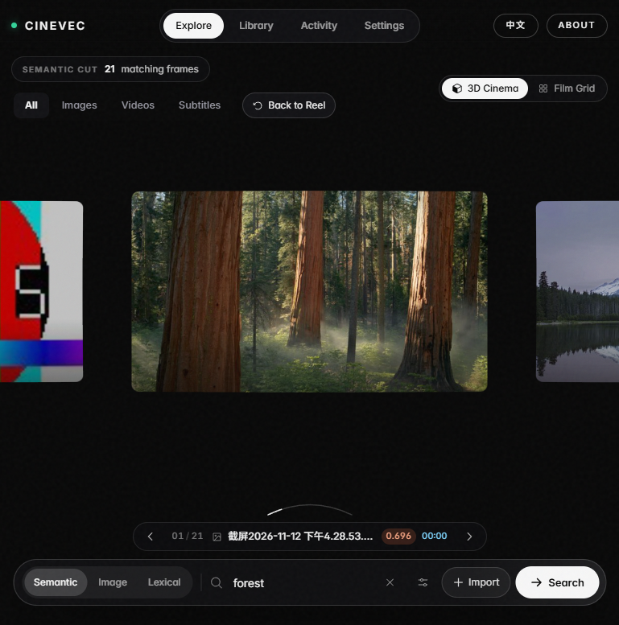
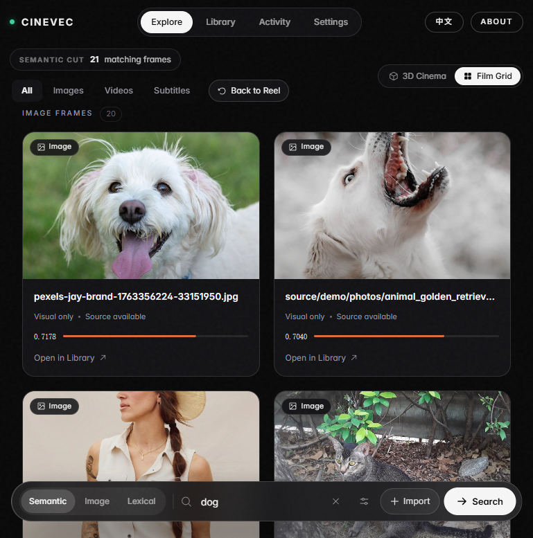
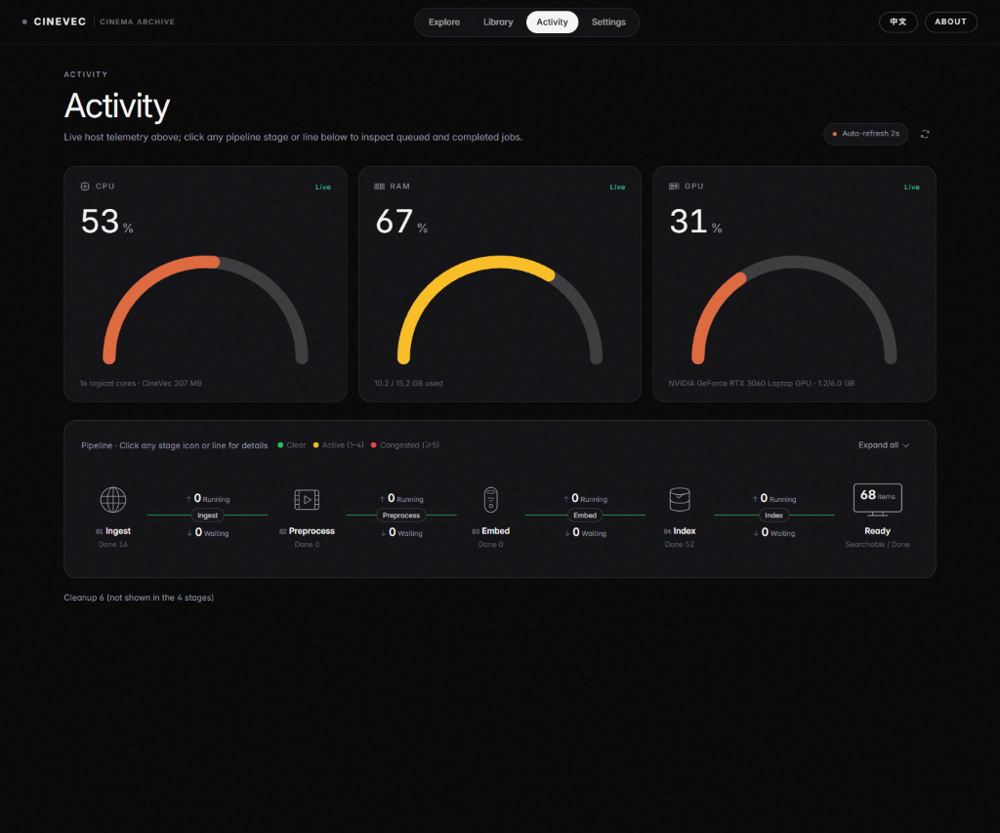
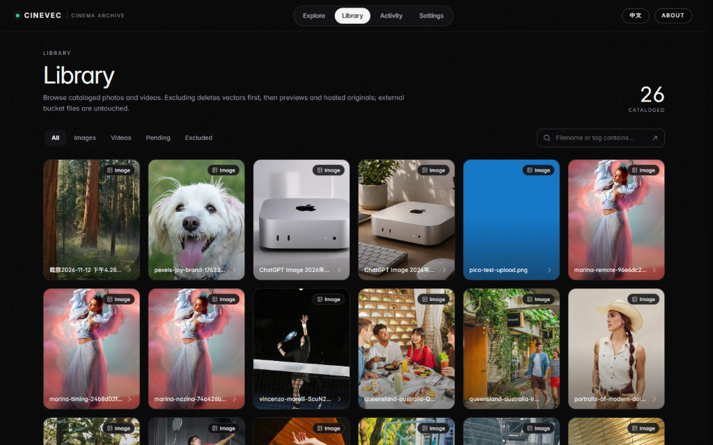
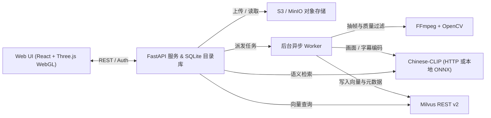

<div align="center">

# CineVec

**自托管多模态媒体检索引擎：电影级 3D 放映室界面 × 零留存原片索引**

[English](README.md) | 简体中文

[](https://www.python.org/)
[](https://fastapi.tiangolo.com/)
[](https://react.dev/)
[](https://threejs.org/)
[](https://milvus.io/)
[](https://min.io/)

</div>

---

## 项目简介

**CineVec** 将你的私有照片与视频档案库转化为可交互的电影级检索放映室。基于 **Chinese-CLIP**（支持远程 HTTP 服务或本地 ONNX）、**Milvus REST v2**、**FFmpeg** 与 **S3 / MinIO** 构建，支持用自然语言描述画面、以图搜片、字幕语义搜索与文件名/标签/描述词法检索——所有数据与向量完全由你自己掌控。

---

## 核心特性

- **3D 影院走廊与沉浸式放映室** — 支持 WebGL 曲面柱面走廊（`3D 影院`）与`胶片网格`双视图。点击任意结果进入**放映室**，支持视频直放、命中时间戳自动跳转、关键帧胶片条、封面替换、描述编辑、标签管理与字幕时间轴浏览。
- **多模态 + 词法混合检索**
  - **语义搜画面**：输入自然语言描述（如「海边的黄昏」「雨里亮着灯的街」）直接定位对应镜头。
  - **以图搜相似**：拖拽任意样图，寻找构图与内容相近的视频帧或图片。
  - **词法检索**：覆盖文件名、标签与描述文本的快速精确包含匹配。
- **零留存索引模式（Zero-Retention）** — 上传时取消勾选「保存源文件到 S3」并填写来源网址（`source_url`），CineVec 在完成抽帧与向量化后仅保留轻量预览图、封面与向量，并自动清理临时源文件，大幅节省存储空间。
- **无损挂载外部 S3 / MinIO 桶** — 可同时接入多个 S3 / MinIO 桶作为只读数据源，绝不搬动或修改原文件；在资料库「排除」资产时，严格先删除 Milvus 向量，再清理预览图与平台托管文件。
- **实时硬件监控与四阶段拓扑仪表盘** — 实时展示宿主机 CPU、内存与 NVIDIA GPU 负载（兼容 Windows / Linux / macOS），并以交通灯拥堵配色展示 `入库 -> 预处理 -> 编码 -> 建索引` 四阶段流水线与队列详情。
- **双语界面（默认英文 / 一键切中文）** — 顶部 HUD 右侧提供 `EN / 中文` 切换按钮。
- **插件友好的 `/api/v1` 接口** — 可在设置页签发独立的 Bearer API Token，方便外挂、机器人或自动化脚本接入。

---

## 界面预览

### 语义搜索 — 3D 影院视图（`"forest"`）


### 语义搜索 — 胶片网格视图（`"dog"`）


### 仪表盘 — 宿主机监控与四阶段流水线拓扑


### 资料库 — 馆藏浏览与元数据编辑抽屉


---

## 系统架构



---

## 快速开始

### 环境依赖

- **Python 3.11+** 与 **Node.js 20+**
- **FFmpeg**（已在 `PATH` 中，或通过 `PICA_FFMPEG_PATH` 指定）
- **Milvus**（v2.4+，需开启 REST API v2）
- **MinIO / S3 兼容对象存储**
- **向量编码服务**（推荐远程 HTTP 编码服务，或本地 Chinese-CLIP ONNX 模型）

### 1. 配置环境变量

复制环境变量模板并填入你的本地服务地址与密钥：

```bash
cp .env.example backend/.env
```

> [!IMPORTANT]
> 请勿将 `backend/.env`、`backend/data/*.db` 或任何真实密码、S3 密钥提交到 Git 仓库。为保持向后兼容，环境变量仍沿用 `PICA_*` 前缀。

### 2. 启动后端

```bash
cd backend
python -m venv .venv

# Windows (PowerShell)
.\.venv\Scripts\Activate.ps1
# Linux / macOS
# source .venv/bin/activate

pip install -r requirements.txt
uvicorn app.main:app --host 127.0.0.1 --port 8008
```

### 3. 启动前端

```bash
cd web
npm install
npm run dev -- --host 127.0.0.1 --port 5174
```

在浏览器打开 **http://127.0.0.1:5174** 即可使用。

---

## 测试与构建

```bash
# 后端单元测试与集成测试
cd backend
pytest -q

# 前端类型检查、生产构建与鉴权存储测试
cd web
npm run build
npm test
```

---

## 目录结构

```text
cinevec/
├── backend/
│   ├── app/
│   │   ├── main.py          # FastAPI 入口与 API / 静态路由
│   │   ├── worker.py        # 四阶段后台流水线与向量清理 Worker
│   │   ├── milvus.py        # Milvus REST v2 客户端与集合管理
│   │   ├── embeddings.py    # 远程 HTTP 与本地 ONNX Chinese-CLIP 编码器
│   │   ├── video.py         # FFmpeg 关键帧采样与废帧过滤
│   │   └── storage.py       # S3 / MinIO 适配层
│   └── tests/               # Pytest 测试套件
├── web/
│   ├── src/
│   │   ├── cinema/          # WebGL 3D 轮播、弧形轨道与放映室
│   │   ├── pages/           # 探索、资料库、仪表盘、设置、登录页
│   │   ├── components/      # 顶部 HUD、导入抽屉、网盘连接、灯箱
│   │   └── i18n.tsx         # EN / 中文 双语状态管理
│   └── package.json
├── docs/images/             # README 预览截图
└── .env.example             # 环境变量参考模板
```
