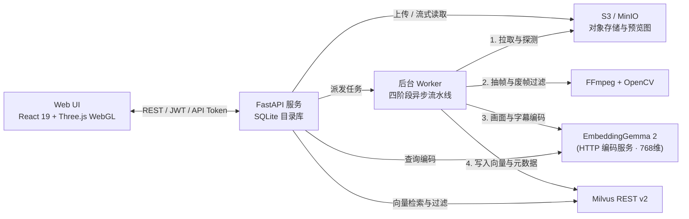

<div align="center">

# CineVec

### 电影级 3D 放映室界面的自托管多模态媒体检索引擎

基于 **Google EmbeddingGemma 2**、**Milvus REST v2**、**FFmpeg** 与 **S3 / MinIO** 构建 — 支持 **零留存原片索引** 与 **中英双语界面 (`EN / 中文`)**。

[English](README.md) · [简体中文](README.zh-CN.md)

[-4285F4?style=for-the-badge&logo=google&logoColor=white)](https://ai.google.dev/)
[](https://milvus.io/)
[](https://fastapi.tiangolo.com/)
[](https://threejs.org/)
[](https://min.io/)

[核心特性](#核心特性) • [界面预览](#界面预览) • [系统架构](#系统架构) • [快速开始](#快速开始) • [配置说明](#配置说明) • [插件接口](#插件与-rest-api)

</div>

---

## 为什么选择 CineVec？

大多数自托管媒体库只停留在文件名或 EXIF 检索。**CineVec** 将高维多模态语义检索与电影级 3D 放映室体验结合到你的私有基础设施中——既不锁定原文件格式，也无需把海量原片重复拷贝多份。

| 核心能力 | CineVec 的实现方式 |
| :--- | :--- |
| **EmbeddingGemma 2 多模态检索** | 默认采用 **`google/embeddinggemma-2`**（768 维 `float32` 向量、`full_frame_passthrough_v1`），同时兼容可插拔的 **Chinese-CLIP**（HTTP 或本地 ONNX）。 |
| **3D WebGL 影院与放映室** | 在 **Three.js 曲面 3D 影院走廊** 或 **胶片网格** 中浏览搜索结果；点击任意命中画面即可进入 **放映室** 直放原片并自动跳转到命中时间戳。 |
| **零留存索引模式** | 上传时取消勾选「保存源文件到 S3」并填写来源网址（`source_url`），系统仅保留轻量预览图、封面与向量，入库后自动清理临时源文件。 |
| **向量优先的安全排除机制** | 在资料库「排除」资产时，严格**先删除 Milvus 向量**，确认成功后才清理预览图与托管原片；外部只读 S3 桶中的原文件绝不改动。 |
| **实时硬件与四阶段流水线** | 跨平台（Windows / Linux / macOS）实时监控 **CPU、RAM 与 NVIDIA GPU** 负载，并以交通灯拥堵配色展示 `入库 → 预处理 → 编码 → 建索引` 四阶段队列。 |
| **中英双语切换 (`EN / 中文`)** | 默认英文界面，顶部 HUD 右侧支持一键切换中英文。 |

---

## 界面预览

### 多模态语义检索 — 3D 影院模式

<table>
  <tr>
    <td width="50%" align="center">
      
      <br />
      <sub><b>搜索词：<code>"forest"</code></b> — 3D 影院走廊居中高亮林间阳光画面（余弦相关度 <code>0.696</code>）</sub>
    </td>
    <td width="50%" align="center">
      
      <br />
      <sub><b>搜索词：<code>"dog"</code></b> — 3D 影院走廊精准召回并置顶宠物画面（余弦相关度 <code>0.718</code>）</sub>
    </td>
  </tr>
</table>

### 宿主机监控、四阶段流水线与资料库

<table>
  <tr>
    <td width="50%" align="center">
      
      <br />
      <sub><b>仪表盘 (Activity)</b> — 实时 CPU / RAM / GPU 仪表与可展开的四阶段交通灯流水线</sub>
    </td>
    <td width="50%" align="center">
      
      <br />
      <sub><b>资料库 (Library)</b> — 分类筛选、批量打标、自定义封面、描述编辑与安全排除</sub>
    </td>
  </tr>
</table>

---

## 核心特性

### 1. 三合一导演搜索台
- **语义搜索**：用自然语言描述画面内容、场景氛围或字幕对白直接定位镜头。
- **以图搜片**：将任意样图拖入舞台，寻找视觉构图与语义最接近的视频帧或照片。
- **词法检索**：覆盖文件名、标签与可编辑描述文本的快速精确包含匹配。

### 2. 沉浸式放映室 (Screening Room)
- **命中时间戳直达**：视频检索命中后自动跳转至对应秒数播放。
- **关键帧胶片条与封面替换**：在抽帧时间轴上快速浏览，支持随时替换视频封面。
- **字幕时间轴**：支持显式绑定 `.srt` / `.vtt` / `.ass` 字幕文件并高亮匹配台词。

### 3. 无损多桶对象存储接入
- 可同时接入多个 S3 / MinIO 桶作为只读数据源（`role: input`），绝不搬动原文件。
- 指定一个桶作为平台存储（`is_platform_storage: true`），用于存放预览图、封面及可选的托管上传文件。

---

## 系统架构



### 四阶段后台流水线

| 阶段 | 名称 | 核心职责 |
| :---: | :--- | :--- |
| `01` | **入库 (Ingest)** | 登记本地上传或外部 S3/MinIO 文件，记录 `asset_id` 与版本溯源信息。 |
| `02` | **预处理 (Preprocess)** | 通过 FFmpeg 抽帧（支持固定间隔、总帧数均匀、每分钟帧数三种模式），过滤纯黑/纯白/模糊/连续相似废帧并生成预览图。 |
| `03` | **编码 (Embed)** | 调用 **EmbeddingGemma 2**（768 维）或 Chinese-CLIP 对关键帧、描述及字幕片段进行向量编码。 |
| `04` | **建索引 (Index)** | 将向量及统一的 `asset_id` / `version` 元数据写入 **Milvus REST v2** 并激活可检索状态。 |

---

## 快速开始

### 环境依赖

- **Python 3.11+** 与 **Node.js 20+**
- **FFmpeg**（已在 `PATH` 中，或通过 `PICA_FFMPEG_PATH` 指定）
- **Milvus v2.4+**（需开启 REST API v2）
- **MinIO** 或任意 S3 兼容对象存储
- **向量编码服务**：运行 **EmbeddingGemma 2**（`google/embeddinggemma-2`，768 维）的远程 HTTP 编码服务，或本地 Chinese-CLIP ONNX 模型

### 1. 配置环境变量

复制环境变量模板并填入你的本地服务地址与密钥：

```bash
cp .env.example backend/.env
```

> [!IMPORTANT]
> 请勿将 `backend/.env`、`backend/data/*.db` 或任何真实密钥提交到 Git。为保持完全向后兼容，环境变量仍沿用 `PICA_*` 前缀。

### 2. 启动后端

```bash
cd backend
python -m venv .venv

# Windows (PowerShell)
.\.venv\Scripts\Activate.ps1
# Linux / macOS
# source .venv/bin/activate

pip install -r requirements.txt
uvicorn app.main:app --host 127.0.0.1 --port 8008
```

### 3. 启动前端

```bash
cd web
npm install
npm run dev -- --host 127.0.0.1 --port 5174
```

在浏览器打开 **http://127.0.0.1:5174** 即可使用。

---

## 配置说明

`backend/.env` 中的核心配置项如下（完整注释版请参考 [`.env.example`](.env.example)）：

| 分组 | 关键变量 | 说明 |
| :--- | :--- | :--- |
| **编码模型 (EmbeddingGemma 2)** | `PICA_ENCODER_BACKEND=remote_http`<br/>`PICA_MODEL_FAMILY=embeddinggemma2`<br/>`PICA_MODEL_ARCHITECTURE=google/embeddinggemma-2`<br/>`PICA_MODEL_DIM=768`<br/>`PICA_PREPROCESS_VERSION=full_frame_passthrough_v1` | 主力多模态向量模型配置，通过 `PICA_CLIP_HTTP_BASE_URL` 对接 HTTP 编码服务。 |
| **Milvus 向量库** | `PICA_MILVUS_URI`, `PICA_MILVUS_DB`, `PICA_MILVUS_USER`, `PICA_MILVUS_PASSWORD` / `PICA_MILVUS_TOKEN` | Milvus REST v2 服务地址与认证信息，支持按 `asset_id` 精确检索与删向量。 |
| **S3 / MinIO 存储** | `PICA_S3_ENDPOINT`, `PICA_S3_BUCKET`, `PICA_S3_ACCESS_KEY`, `PICA_S3_SECRET_KEY` | 平台存储配置，存放预览图、封面及可选的托管原片。 |
| **抽帧与队列限流** | `PICA_SAMPLE_INTERVAL_SECONDS=5.0`<br/>`PICA_MAX_UPLOAD_FILES=20` | 默认视频抽帧间隔与单次上传文件数上限（可在设置页 `1–500` 动态调整）。 |

---

## 插件与 REST API

可在网页端 **Settings → Plugin API Tokens** 生成 Bearer Token，供外部机器人、浏览器插件或脚本调用 `/api/v1/*`：

```bash
# 使用 Bearer Token 进行语义检索
curl -X POST http://127.0.0.1:8008/api/v1/search \
  -H "Authorization: Bearer <YOUR_API_TOKEN>" \
  -H "Content-Type: application/json" \
  -d '{"query": "redwood forest sunlight", "top_n": 10}'
```

---

## 测试与构建

```bash
# 后端单元测试与集成测试
cd backend
pytest -q

# 前端 TypeScript 检查、生产构建与鉴权存储测试
cd web
npm run build
npm test
```

---

## 目录结构

```text
Cinevec/
├── backend/
│   ├── app/
│   │   ├── main.py                        # FastAPI 入口、API 路由与静态托管
│   │   ├── application/
│   │   │   ├── lifecycle_service.py       # 排除、恢复与向量优先安全清理
│   │   │   ├── pipeline_service.py        # 四阶段后台流水线编排与断点续传
│   │   │   └── search_service.py          # 多模态与字幕融合检索
│   │   ├── milvus.py                      # Milvus REST v2 客户端与集合管理
│   │   ├── embeddings.py                  # EmbeddingGemma 2 HTTP 与 Chinese-CLIP 编码器
│   │   ├── video.py                       # FFmpeg 关键帧采样与质量过滤
│   │   └── storage.py                     # S3 / MinIO 对象存储适配层
│   └── tests/                             # Pytest 测试套件
├── web/
│   ├── src/
│   │   ├── cinema/                        # Three.js 3D 轮播、弧形轨道、放映室
│   │   ├── pages/                         # 探索、资料库、仪表盘、设置、登录页
│   │   ├── components/                    # 顶部 HUD、导入抽屉、网盘连接、灯箱
│   │   └── i18n.tsx                       # EN / 中文 双语状态管理
│   └── package.json
├── docs/images/                           # 实机验证截图
└── .env.example                           # 环境变量参考模板
```
